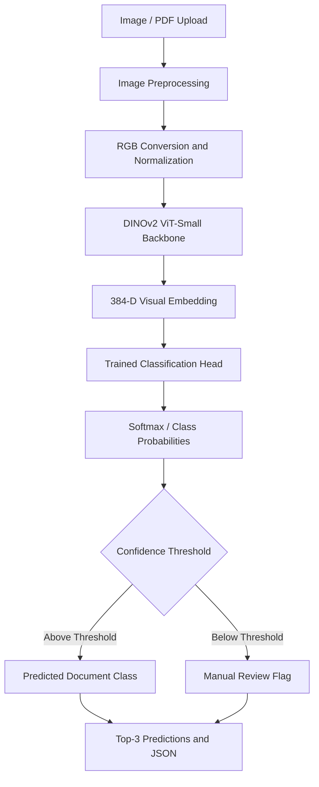

# DINOv2 Vision Transformer – Intelligent Motor Document Classification

A deep learning-based document classification system leveraging Meta's pretrained DINOv2 Vision Transformer and transfer learning to automatically classify motor insurance documents based on visual representations.

## 1. Project Overview

Motor insurance claim intake systems receive diverse documents, including driving licences, vehicle registrations, national identity cards, police accident reports, repair invoices and vehicle damage photographs.

Incorrect document classification can lead to downstream extraction failures, processing delays and additional manual intervention.

Traditional keyword-based classification approaches depend heavily on OCR quality and textual content, making them less reliable for blurred, degraded, multilingual and image-based documents.

This project introduces a Vision Transformer-based classification architecture using DINOv2 to learn visual document representations and classify incoming documents based on their structural and semantic visual features.

**Key objectives:**
- Automate document classification during motor insurance claim intake.
- Reduce dependence on OCR-based keyword classification.
- Leverage pretrained foundation vision models through transfer learning.
- Support classification of visually similar document categories.
- Provide confidence-aware predictions for downstream processing systems.

## 2. Architecture

The system uses a feature extraction and classification architecture built around a pretrained DINOv2 Vision Transformer.

Instead of training a complete vision model from scratch, the pretrained DINOv2 backbone extracts visual embeddings from document images. A lightweight classification head uses these embeddings to predict the document category.

### Processing Workflow

1. Receive document images or PDF uploads through the classification service.
2. Convert PDF pages into RGB images using PyMuPDF when required.
3. Resize and normalize images to the model's expected input dimensions.
4. Pass image tensors through the pretrained DINOv2 ViT-Small backbone.
5. Extract 384-dimensional CLS-token visual embeddings.
6. Pass the embeddings to a trained Logistic Regression classification head.
7. Calculate class probabilities and rank the predicted categories.
8. Apply confidence thresholding to identify uncertain predictions.
9. Return the predicted document class, confidence score and top-three alternatives as structured JSON.

### Architecture Diagram

## 3. Key Technical Contributions

### Vision Transformer Feature Extraction
- Integrated Meta's pretrained DINOv2 ViT-Small (`dinov2_vits14`) architecture.
- Used a frozen Vision Transformer backbone to extract visual representations.
- Generated 384-dimensional CLS-token embeddings for document images.
- Leveraged self-supervised visual representations for document classification.

### Transfer Learning and Classification
- Designed a feature extraction pipeline using pretrained DINOv2 representations.
- Trained a lightweight Multinomial Logistic Regression classifier using extracted embeddings.
- Applied transfer learning to reduce the need for large-scale end-to-end model training.
- Used cached embeddings to accelerate repeated classifier training and experimentation.

### Confidence-Based Classification
- Implemented class probability scoring and top-three prediction ranking.
- Applied confidence thresholding to identify uncertain document classifications.
- Designed fallback routing for low-confidence predictions to support manual verification.

### Model Evaluation and Benchmarking
- Evaluated classification performance using accuracy and confusion matrices.
- Analyzed class-level prediction errors and visual similarities between document categories.
- Compared DINOv2-based classification against alternative approaches, including ResNet-50 and OCR-based classification.
- Investigated front-versus-back document classification challenges.

### Production Inference Engineering
- Developed a FastAPI-based classification service.
- Integrated PyTorch inference and Scikit-learn classification components.
- Implemented PDF-to-image conversion and image preprocessing.
- Designed structured JSON responses for downstream document processing services.

## 4. Technology Stack

| Category | Technologies |
|---|---|
| Language | Python |
| Deep Learning | PyTorch, Torchvision |
| Foundation Vision Model | Meta DINOv2 ViT-Small |
| Model Integration | Hugging Face Transformers |
| Machine Learning | Scikit-learn |
| Image Processing | Pillow, OpenCV, NumPy |
| PDF Processing | PyMuPDF |
| Backend | FastAPI, Uvicorn |
| Model Persistence | Joblib, PyTorch Checkpoints |
| Experimentation | Jupyter Notebook, PyTorch Profiler |

## 5. Performance and Business Impact

- **Classification accuracy:** Achieved a reported accuracy of over 96% across the evaluated motor document classes.
- **Automated triage:** Enabled automatic document classification before downstream extraction.
- **Reduced OCR dependency:** Used visual embeddings rather than relying exclusively on OCR text and keyword matching.
- **Efficient training:** Used a frozen pretrained backbone and lightweight classifier to reduce training requirements.
- **CPU-friendly classification head:** Enabled lightweight classification using standard CPU inference infrastructure.

*Note: Classification accuracy and latency figures should be accompanied by the evaluation dataset, class distribution, test methodology and hardware configuration when available.*

## 6. Engineering Challenges

| Challenge | Solution |
|---|---|
| Poor OCR quality in degraded documents | Used visual feature representations from DINOv2 |
| Similar front and back document layouts | Leveraged pretrained visual embeddings to distinguish structural patterns |
| Limited labeled training data | Applied transfer learning with a frozen pretrained backbone |
| Repeated feature extraction overhead | Cached embeddings for subsequent classifier experiments |
| Uncertain document predictions | Introduced confidence thresholding and manual-review routing |
| Downstream extraction failures | Added classification before specialized extraction pipelines |

## 7. Model Architecture and Design Decisions

### Why DINOv2?

DINOv2 is a self-supervised Vision Transformer designed to learn general-purpose visual representations from large-scale image data.

Its pretrained representations can be reused for downstream classification tasks without training a complete vision backbone from scratch.

### Feature Extraction

The project uses the DINOv2 ViT-Small architecture with a 384-dimensional CLS-token representation.

The extracted embeddings capture visual information that can help distinguish document categories based on layout, appearance and structural characteristics.

### Transfer Learning

The pretrained DINOv2 backbone is kept frozen while a separate Logistic Regression classifier is trained on the extracted feature vectors.

This approach offers:
- Reduced training complexity.
- Faster experimentation with limited labeled datasets.
- Reusable visual embeddings.
- Lightweight downstream classification.

## 8. Project Highlights

- Foundation Vision Transformer deployment using DINOv2.
- Self-supervised visual representation learning.
- Frozen-backbone transfer learning.
- 384-dimensional visual embedding extraction.
- Logistic Regression-based document classification.
- Confidence-aware prediction and manual-review routing.
- FastAPI-based production inference integration.

## 9. Disclaimer

This repository documents the project's architecture, technical approach and engineering contributions. It does not contain proprietary source code, confidential insurance documents, customer information or sensitive business data.
