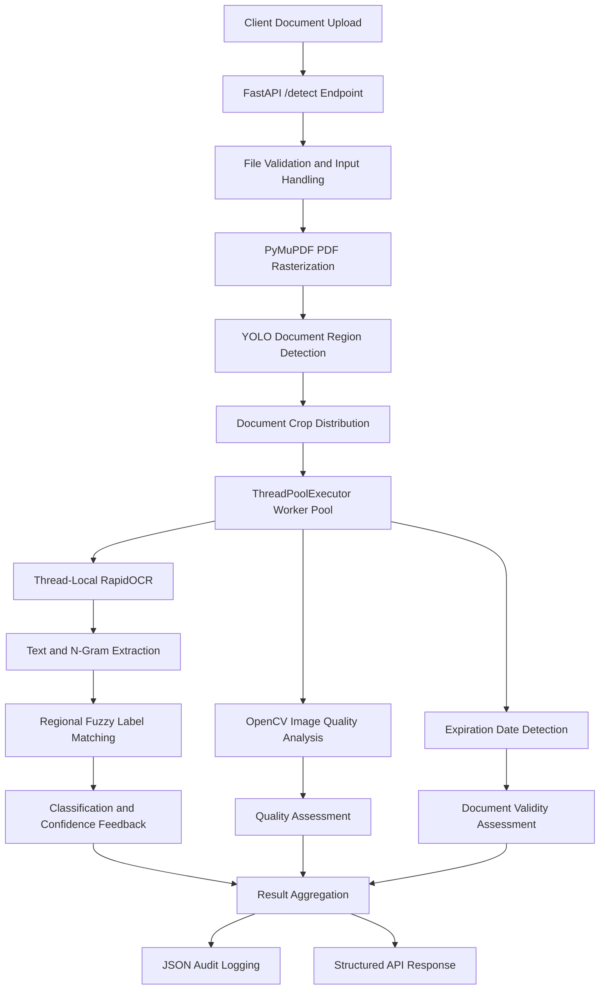

# Intelligent Document Triage – High-Throughput Classification & Quality Screening API

## 1. Project Overview

**Business Domain:** Insurance Technology | Document Intelligence | AI Systems Engineering

This project implements a lightweight document-intake triage microservice for insurance workflows. Its purpose is to identify incoming documents, assess their visual quality, verify expiration dates, and provide regional document classification before they enter downstream extraction pipelines.

Rather than sending every uploaded file directly to computationally expensive document extraction services, the system performs an initial screening using local computer vision, OCR and text-matching techniques.

The service is designed as an independent FastAPI component that can be deployed and scaled separately from downstream document extraction applications.

**Supported regional configurations:**
- UAE
- Doha
- Oman
- Kuwait

## 2. Architecture and Workflow

### Processing stages

1. **Document ingestion:** Receives multipart file uploads, a reference identifier and a regional configuration through a FastAPI endpoint.
2. **PDF rasterization:** Uses PyMuPDF to convert PDF pages into RGB image buffers at 150 DPI.
3. **Document region detection:** Uses a YOLO model to identify document regions and generate individual crops from composite images.
4. **Concurrent processing:** Distributes document crops across a `ThreadPoolExecutor` configured with up to 10 workers.
5. **Local OCR:** Uses RapidOCR to extract text and spatial coordinates from the document images.
6. **Regional classification:** Generates one-, two- and three-word n-grams and compares extracted text against regional JSON label dictionaries using RapidFuzz.
7. **Expiration screening:** Uses regular-expression-based date extraction and date comparison to identify potentially expired documents.
8. **Visual quality assessment:** Applies OpenCV-based image measurements to identify blur, darkness, overexposure, low contrast and insufficient resolution.
9. **Response generation:** Combines classification, validity and image-quality results into a structured JSON response.
10. **Audit logging:** Records processing information in an output JSON log for operational traceability.

## 3. Core Technical Contributions

### A. Independent Document Triage Architecture

Designed a dedicated FastAPI microservice that separates document identification and quality screening from downstream field extraction.

**Engineering value:**
- Reduces unnecessary requests to heavier extraction services.
- Enables independent deployment and scaling of intake processing.
- Provides early feedback about document quality and classification.
- Establishes a consistent pre-processing interface for downstream systems.

### B. YOLO-Based Document Region Detection

Integrated a custom YOLO model (`yolo-multipage-OCR-cls.pt`) to identify document regions within uploaded images.

Configured inference with:
- Image size: 320
- Confidence threshold: 0.25

Detected regions are cropped and passed to subsequent OCR and classification stages.

This approach supports composite uploads containing multiple document regions without requiring the entire image to be processed as one document.

### C. Local OCR and Regional Text Classification

Integrated RapidOCR for local CPU-based text extraction.

Developed a regional label-matching mechanism using:
- One-word n-grams
- Two-word n-grams
- Three-word n-grams
- RapidFuzz similarity scoring
- Region-specific JSON label dictionaries

This enables document classification based on extracted textual patterns without requiring a separate trained classifier for every regional document category.

### D. OpenCV-Based Image Quality Assessment

Implemented image metrology routines to evaluate whether uploaded document images are suitable for further processing.

| Quality indicator | Measurement | Example threshold |
|---|---|---:|
| Blur | Laplacian variance | Below 80 |
| Darkness | Mean pixel brightness | Below 50 |
| Overexposure | Mean pixel brightness | Above 220 |
| Low contrast | Pixel intensity standard deviation | Below 30 |
| Low resolution | Total pixel count | Below 500,000 |

These measurements provide interpretable quality feedback to the client application.

Thresholds are configurable heuristics and should be calibrated against representative document images.

### E. Expiration Date Screening

Implemented regular-expression-based date extraction and expiration checks.

The service compares extracted expiration dates against the current date and flags documents that appear expired.

This provides an early validity screening step before downstream document extraction or manual review.

### F. Concurrent Processing and Worker Isolation

Implemented parallel processing using Python's `ThreadPoolExecutor` with a maximum of 10 workers.

Used thread-local RapidOCR instances through `threading.local()` to isolate OCR objects across worker threads.

This design addresses observed shared-instance contention and supports concurrent document processing.

## 4. Technology Stack

| Category | Technologies |
|---|---|
| Programming Language | Python 3.10+ |
| API Framework | FastAPI, Uvicorn |
| Computer Vision | OpenCV |
| Object Detection | Ultralytics YOLOv8 |
| OCR | RapidOCR, ONNX Runtime |
| PDF Processing | PyMuPDF |
| Text Matching | RapidFuzz |
| Numerical Processing | NumPy |
| Concurrency | ThreadPoolExecutor, threading.local |
| Validation | Pydantic |
| Optional OCR Integration | Azure AI Document Intelligence |
| Deployment | Nginx, Uvicorn |
| Configuration | Regional JSON label dictionaries |

## 5. API and Deployment Design

**Primary endpoint:**

`POST /detection/detect`

The service accepts document uploads alongside a reference identifier and regional configuration.

The deployment architecture uses:
- FastAPI for request handling and orchestration.
- Uvicorn as the ASGI application server.
- Nginx for reverse-proxy routing.
- Regional JSON configurations for classification rules.
- JSON-based processing records for operational traceability.

The service is designed to operate independently of downstream extraction applications.

## 6. Engineering Challenges and Design Decisions

| Challenge | Engineering approach |
|---|---|
| Composite images containing multiple documents | YOLO-based region detection and cropping |
| High-volume document submissions | Concurrent worker processing |
| Shared OCR instance contention | Thread-local OCR object initialization |
| Regional document variations | Region-specific label dictionaries |
| Unreadable document uploads | OpenCV-based quality measurements |
| Expired credentials | Regex-based date extraction and validation |
| Large PDF uploads | Controlled rasterization resolution and memory-conscious processing |
| Downstream extractor overload | Independent intake screening layer |

### Architectural trade-offs

- **Local OCR:** Reduces dependence on external OCR API calls, but requires local CPU and memory capacity.
- **Rule-based classification:** Provides transparent, configurable matching, but can be sensitive to OCR errors and variations in document wording.
- **Image-quality heuristics:** Offer fast and interpretable checks, but require calibration to avoid rejecting usable images.
- **Thread-based concurrency:** Improves workload distribution for suitable I/O and native-library operations, but does not guarantee linear throughput scaling.
- **JSON audit logging:** Provides a lightweight audit trail, but concurrent production workloads may require a transactional or append-safe storage mechanism.

## 7. Business Applications and Value

The service is applicable to:

- Motor insurance claim document intake.
- Regional identity and vehicle document classification.
- Document quality screening at the point of upload.
- Expiration-date pre-validation.
- Pre-processing gateways for OCR and document extraction systems.
- Reducing unnecessary processing of unreadable or irrelevant uploads.

By screening documents before downstream extraction, the architecture can help reduce avoidable compute consumption and improve the quality of documents entering subsequent processing stages.

## 8. Key Skills Demonstrated

- High-throughput API architecture
- FastAPI microservice development
- YOLO-based computer vision
- OCR integration and text processing
- Fuzzy matching and n-gram classification
- OpenCV image quality analysis
- Concurrent processing and thread-local resource management
- PDF processing and image rasterization
- Regional configuration management
- Nginx reverse-proxy deployment
- AI pipeline optimization and service decoupling

## 9. Project Scope and Disclaimer

This repository describes the system architecture and engineering approach. It excludes proprietary source code, internal insurance documents, customer information, credentials and confidential infrastructure configurations.

The service provides preliminary document classification, quality assessment and expiration screening. Its results should be treated as automated triage signals rather than definitive legal, identity or insurance validity decisions.

Production deployment requires appropriate performance benchmarking, concurrency-safe logging, security controls, monitoring, resource limits and validation against representative regional document datasets.
