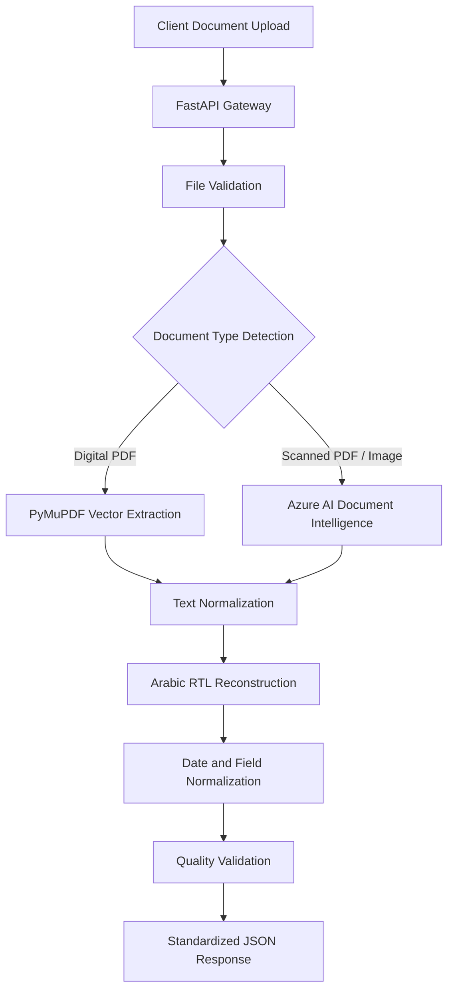

# Qatar Document Intelligence API – Hybrid AI Extraction Platform

A production-oriented document intelligence microservice designed to automate the extraction and normalization of Qatar government and motor insurance documents using a hybrid architecture combining local PDF processing and Azure AI Document Intelligence.

## 1. Project Overview

The platform automates document processing for motor insurance operations and enterprise identity verification in Qatar.

It supports four major document categories:

- Qatar ID (QID) / Residency Permit
- Qatar Driving Licence
- Vehicle Registration Card (Mulkiya)
- Ministry of Interior (MOI) Traffic Police Accident Reports

These documents contain bilingual Arabic-English content, complex layouts, tabular structures and varying image quality. The system addresses these challenges through intelligent document routing, coordinate-based extraction, neural OCR and language-specific post-processing.

## 2. Architecture

The service uses a dual-path extraction architecture to optimize processing time and cloud API consumption.

**Processing workflow:**

1. Receive and validate document uploads through FastAPI.
2. Inspect PDF content to identify digitally generated versus scanned documents.
3. Route digital PDFs to local vector-based extraction using PyMuPDF.
4. Route scanned documents and image uploads to Azure AI Document Intelligence.
5. Reconstruct Arabic text and normalize extracted values.
6. Apply extraction quality checks and return standardized JSON responses.

### Architecture Diagram

## 3. Key Technical Contributions

### Hybrid Document Extraction
- Designed a dual-path extraction engine that distinguishes digitally generated PDFs from scanned documents.
- Implemented local text and coordinate extraction using PyMuPDF.
- Integrated Azure custom neural extraction models for scanned documents.
- Reduced unnecessary cloud OCR requests through intelligent routing.

### Coordinate-Based PDF Parsing
- Extracted text spans and spatial bounding boxes from native PDF content.
- Developed coordinate-based grouping to reconstruct logical rows and tabular structures.
- Handled multi-page MOI police accident reports containing incident details and vehicle-party information.

### Arabic Language Processing
- Implemented Arabic text reshaping using `arabic-reshaper`.
- Integrated bidirectional text handling using `python-bidi`.
- Normalized multilingual text and date fields for downstream processing.

### Backend and API Engineering
- Developed RESTful endpoints using FastAPI.
- Implemented file validation, request identification and structured exception handling.
- Designed standardized JSON response contracts using Pydantic.
- Containerized the service using Docker and documented API endpoints through Swagger/OpenAPI.

## 4. Technology Stack

| Category | Technologies |
|---|---|
| Language | Python |
| Backend | FastAPI, Uvicorn, Pydantic |
| PDF Processing | PyMuPDF |
| Document AI | Azure AI Document Intelligence |
| NLP / Localization | arabic-reshaper, python-bidi |
| Image Processing | Pillow, NumPy |
| Deployment | Docker |
| API Documentation | Swagger UI, OpenAPI |

## 5. Performance and Business Impact

- **~90% reduction** in manual motor claim registration time through document extraction automation.
- **~70% reduction** in cloud API usage through local processing of digitally generated documents.
- Enabled automated ingestion of four Qatar document categories.
- Improved data consistency through field normalization and extraction quality validation.
- Established a reusable JSON response contract for integration with downstream enterprise services.

*Note: Performance and business impact figures represent the reported project outcomes and should be interpreted in the context of the project's evaluation baseline.*

## 6. Engineering Challenges

| Challenge | Solution |
|---|---|
| Arabic-English mixed text | Arabic reshaping and bidirectional text reconstruction |
| Complex MOI report tables | Coordinate-based text grouping and row reconstruction |
| Unnecessary cloud OCR calls | Digital-versus-scanned PDF routing |
| Inconsistent extraction output | Standardized JSON response and validation |
| Multi-page document layouts | Coordinate-aware extraction across pages |

## 7. Project Highlights

- Hybrid local and cloud document extraction architecture.
- Intelligent document routing and processing.
- Arabic-English document normalization.
- Production-oriented REST API development.
- Cloud processing cost optimization.

## 8. Disclaimer

This repository describes the technical architecture and engineering contributions of the project. It does not contain confidential customer documents, proprietary source code, credentials, or sensitive insurance data.
