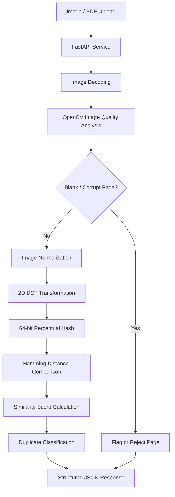

# Intelligent Insurance Claims – Image Duplication & Fraud Detection Engine

A computer vision-based image integrity and duplicate detection microservice designed to identify identical and near-identical images across motor insurance claims, while automatically filtering blank and corrupted document pages.

## 1. Project Overview

Insurance claim submissions frequently contain repeated accident photographs, repair invoices and supporting documents. Images may also be resized, recompressed or slightly cropped before being resubmitted across different claims.

Traditional cryptographic hashing methods such as MD5 and SHA-256 cannot reliably identify visually identical images after such modifications because even minor pixel changes produce completely different hashes.

This project implements a perceptual image similarity engine using Discrete Cosine Transform (DCT)-based perceptual hashing (pHash) to identify visually similar images despite common transformations.

The platform also integrates image quality analysis to detect blank, overexposed, underexposed and corrupted pages before they enter downstream document processing pipelines.

**Key objectives:**
- Detect identical and near-identical insurance claim images.
- Identify visually similar images despite resizing and recompression.
- Filter blank and low-information document pages.
- Reduce redundant processing in downstream OCR and document intelligence services.
- Provide a lightweight REST API for integration with insurance claim intake systems.

## 2. Architecture

The platform follows a multi-stage image integrity and similarity analysis architecture.

### Processing Workflow

1. Receive individual images, batches or multi-page PDF documents through FastAPI.
2. Decode input files into grayscale image arrays using OpenCV and NumPy.
3. Evaluate image quality using Laplacian variance and pixel intensity statistics.
4. Flag blank, overexposed, underexposed and invalid image inputs.
5. Resize valid images into a canonical representation.
6. Apply the 2D Discrete Cosine Transform to extract low-frequency visual information.
7. Generate a 64-bit perceptual hash for each image.
8. Compare hashes using Hamming distance.
9. Calculate similarity scores and classify images as duplicates, near-duplicates or unique submissions.
10. Return structured JSON results containing similarity scores and image quality flags.

### Architecture Diagram

## 3. Key Technical Contributions

### Perceptual Image Hashing
- Implemented DCT-based perceptual hashing to represent image structure using low-frequency spatial information.
- Generated compact 64-bit image fingerprints for efficient comparison.
- Designed image normalization to improve consistency across different image resolutions and compression levels.
- Used perceptual hashes instead of cryptographic hashes for visual similarity detection.

### Similarity Detection Algorithms
- Implemented Hamming distance calculation between perceptual hash representations.
- Developed similarity scoring and threshold-based duplicate classification.
- Distinguished exact visual matches, near-duplicates and unique submissions.
- Implemented batch image comparison to evaluate multiple candidate images efficiently.

### Image Quality and Blank Page Detection
- Used Laplacian variance to estimate image sharpness and structural detail.
- Analyzed pixel intensity distributions to identify blank, overexposed and underexposed images.
- Implemented image integrity checks to filter invalid or corrupted inputs.
- Prevented unnecessary processing of low-information pages by downstream OCR services.

### Computer Vision and Image Processing
- Used OpenCV for grayscale conversion, image normalization and pixel-level analysis.
- Applied NumPy for efficient image array manipulation.
- Processed multi-page PDF documents using PyMuPDF.
- Designed in-memory image processing to avoid unnecessary intermediate file storage.

### Backend API Engineering
- Developed stateless REST endpoints using FastAPI.
- Supported individual image uploads, batch comparisons and PDF-based inputs.
- Returned structured JSON containing duplicate classifications and image quality indicators.
- Integrated API documentation and testing workflows.

## 4. Technology Stack

| Category | Technologies |
|---|---|
| Language | Python |
| Backend | FastAPI, Uvicorn |
| Computer Vision | OpenCV |
| Numerical Computing | NumPy |
| Image Processing | Pillow, ImageHash |
| PDF Processing | PyMuPDF |
| Algorithms | DCT, pHash, Hamming Distance |
| Image Quality Analysis | Laplacian Variance, Pixel Intensity Statistics |
| Testing | PyTest, Jupyter Notebook |
| API Documentation | Swagger UI, OpenAPI |

## 5. Performance and Business Impact

- **Fast hash generation:** Achieved a reported perceptual hash generation time of under 5 milliseconds per image in the tested environment.
- **Duplicate detection:** Enabled identification of visually similar images despite resizing and recompression.
- **Processing optimization:** Filtered blank and redundant pages before downstream OCR and document extraction.
- **Fraud prevention support:** Introduced an automated image similarity screening mechanism for motor insurance claim submissions.
- **Operational efficiency:** Reduced unnecessary image processing and improved claim intake quality checks.

*Note: Image similarity is a screening signal, not proof of insurance fraud. The reported processing time depends on image dimensions and hardware. Final fraud decisions require additional claim and contextual verification.*

## 6. Engineering Challenges

| Challenge | Solution |
|---|---|
| Different hashes for visually identical images | Used DCT-based perceptual hashing instead of cryptographic hashing |
| Resized and recompressed images | Applied canonical image normalization before hashing |
| Blank scanned pages | Implemented Laplacian variance and intensity-based analysis |
| Similar document templates causing false positives | Calibrated Hamming distance thresholds and explored multi-region comparison |
| Large batch comparisons | Used compact hash representations and efficient distance calculations |
| Corrupt image inputs | Added decoding and image integrity validation |

## 7. Algorithmic Design Decisions

### Why Perceptual Hashing?

Cryptographic hashing produces a fingerprint based on exact file content. A minor modification, such as resizing or JPEG recompression, changes the resulting hash completely.

Perceptual hashing instead captures visual characteristics of an image, allowing similar images to produce comparable hash representations.

### DCT-Based Perceptual Hashing

The image is resized and converted into grayscale before applying a two-dimensional Discrete Cosine Transform.

Low-frequency coefficients capture broad image structure. These coefficients are thresholded to produce a compact binary representation.

### Hamming Distance

The Hamming distance measures the number of differing bits between two perceptual hashes.

A lower distance indicates greater visual similarity, while a higher distance indicates greater visual difference.

The system uses calibrated thresholds to classify candidate images into duplicate, near-duplicate and unique categories.

## 8. Project Highlights

- DCT-based perceptual image hashing.
- Hamming distance-based similarity detection.
- Automated blank and low-quality page filtering.
- Batch image comparison and duplicate classification.
- Computer vision-based image integrity analysis.
- FastAPI-based insurance claims integration.

## 9. Disclaimer

This repository documents the project's algorithms, architecture and engineering contributions. It does not contain proprietary source code, confidential insurance claim images, customer information or sensitive business data.
