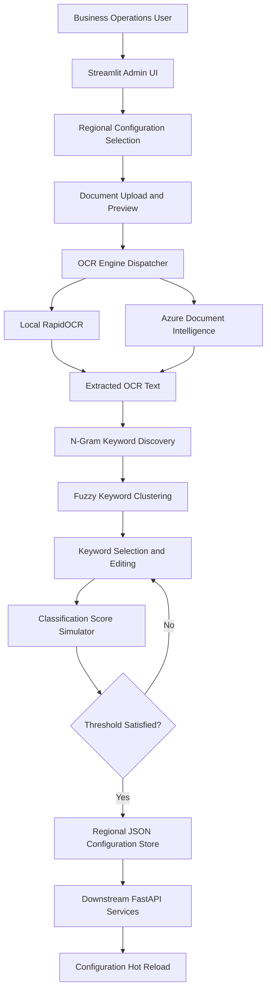

# Intelligent Label Studio – No-Code Document Classification & MLOps Platform

A Streamlit-based administrative platform that enables business operations teams to maintain document classification labels, discover keyword patterns from OCR-extracted text, simulate classification performance and update production configurations without requiring application redeployment.

## 1. Project Overview

Document classification systems used in insurance environments must continuously adapt to changes in government-issued identity documents, regional templates and document layouts.

Traditionally, updating classification keywords or document-specific rules required engineering intervention, source-code modifications and application deployments.

This project introduces a no-code document classification administration platform that transfers routine label maintenance to authorized business operations teams.

The application combines OCR extraction, automated n-gram keyword discovery, fuzzy matching and interactive threshold simulation to help operators create and validate classification rules.

**Key objectives:**
- Enable non-technical users to maintain document classification labels.
- Automatically discover useful keyword patterns from sample documents.
- Support multiple OCR engines for document text extraction.
- Simulate classification results before committing configuration changes.
- Support regional classification configurations.
- Update downstream classification services through configuration hot-reloading.

## 2. System Architecture

The platform uses a configuration-driven architecture in which document classification rules are stored independently of application source code.

### Core Components

1. **Regional Configuration Management:** Provides jurisdiction-specific configuration selection for UAE, Doha, Oman and Kuwait.
2. **Document Ingestion and Preview:** Accepts image and PDF samples and renders PDF previews using PyMuPDF.
3. **Dual-Engine OCR:** Supports local RapidOCR and Azure AI Document Intelligence for text extraction.
4. **N-Gram Keyword Discovery:** Generates unigram, bigram and trigram candidates from extracted OCR text.
5. **Fuzzy Keyword Clustering:** Groups similar phrases using RapidFuzz to identify potential classification keywords.
6. **Classification Simulation:** Tests proposed labels and keywords against uploaded samples using a configurable scoring threshold.
7. **Configuration Persistence:** Saves approved label configurations into regional JSON stores for downstream consumption.

### End-to-End Workflow

1. Operator selects the active insurance jurisdiction.
2. Application loads the corresponding regional label configuration.
3. Operator uploads sample identity documents or PDFs.
4. Application renders document previews and extracts text through the selected OCR engine.
5. The keyword discovery engine generates n-gram candidates from the extracted text.
6. Similar keyword candidates are grouped using fuzzy string matching.
7. Operator reviews, edits and selects proposed classification keywords.
8. The scoring engine evaluates the proposed label against uploaded documents.
9. Operator adjusts the classification threshold and reviews matching results.
10. Approved configurations are persisted to the regional JSON store.
11. Downstream classification services consume the updated configuration through their hot-reload mechanism.

### Architecture Diagram

## 3. Key Technical Contributions

### Automated N-Gram Keyword Discovery

Developed a keyword suggestion mechanism to identify potentially useful classification features from batches of OCR-extracted documents.

- Implemented unigram, bigram and trigram extraction.
- Applied token-length filtering to remove short and low-information candidates.
- Identified recurring phrases across multiple uploaded documents.
- Used RapidFuzz partial-ratio matching to group similar keyword candidates.
- Added a fallback mechanism for single-document submissions.
- Enabled operators to review and edit suggestions before using them in classification rules.

### Dual-Engine OCR Integration

Integrated two OCR execution paths to support different operational requirements.

- RapidOCR for local CPU-based text extraction.
- Azure AI Document Intelligence for cloud-based extraction.
- Added OCR engine selection through the Streamlit interface.
- Designed the workflow around a common extracted-text representation so downstream keyword processing remains independent of the selected OCR engine.

### Interactive Classification Simulator

Implemented a scoring interface to test proposed document labels against uploaded samples.

- Integrated RapidFuzz-based keyword matching.
- Developed configurable classification thresholds.
- Displayed matching scores for uploaded documents.
- Enabled operators to revise keywords and evaluate the effect of changes before saving.
- Added validation logic to control configuration submission.

### Configuration-Driven Hot Reloading

Designed a configuration persistence mechanism that separates classification rules from application code.

- Maintained regional JSON configuration stores.
- Implemented serialization and persistence of approved label-keyword mappings.
- Enabled downstream services to consume updated configurations without requiring a code deployment.
- Used a shared configuration interface between the administrative application and classification services.

### Streamlit Administrative Interface

Developed an interactive browser-based administration application.

- Implemented regional selection using a mandatory dialog.
- Integrated multiple document uploads and PDF previews.
- Used Streamlit session state to manage reactive application workflows.
- Added interactive keyword selection, threshold controls and submission feedback.
- Integrated the application with an Nginx reverse proxy, including WebSocket upgrade routing where required.

## 4. Technology Stack

| Category | Technologies |
|---|---|
| Language | Python |
| Admin UI | Streamlit |
| Backend Integration | FastAPI |
| Local OCR | RapidOCR, ONNX Runtime |
| Cloud OCR | Azure AI Document Intelligence |
| Text Matching | RapidFuzz |
| Feature Engineering | N-Gram Extraction |
| PDF Processing | PyMuPDF |
| Image Processing | OpenCV, Pillow |
| Configuration Storage | JSON |
| Reverse Proxy | Nginx |
| Application Server | Streamlit Server |

## 5. Performance and Business Impact

- **Faster configuration updates:** Reduced the reported turnaround time for supporting a new regional document layout from approximately three days of developer effort to five minutes of business-user configuration.
- **Reduced engineering dependency:** Enabled authorized operations teams to maintain routine classification keywords without submitting code-change requests.
- **Configuration hot reloading:** Eliminated application restarts for supported label updates through the configuration consumption mechanism.
- **Regional scalability:** Standardized document label administration across UAE, Doha, Oman and Kuwait.
- **Flexible OCR processing:** Provided both local and cloud OCR execution options.

*Reported operational improvements should be validated against deployment records or internal measurements before being presented as independently benchmarked results.*

## 6. Engineering Challenges

| Challenge | Solution |
|---|---|
| Keyword discovery from inconsistent OCR output | Implemented n-gram extraction and fuzzy matching |
| Single-document uploads producing insufficient frequency data | Added a single-sample fallback mechanism |
| Different regional document templates | Introduced jurisdiction-specific configuration stores |
| Classification errors from overly broad keywords | Added interactive scoring and threshold simulation |
| Configuration updates requiring deployments | Decoupled classification rules from application code |
| Different OCR accuracy and execution requirements | Integrated local and cloud OCR engines |

## 7. Architectural Design Decisions

### Why N-Gram Extraction?

Single-word matching can miss useful document patterns, particularly when document identifiers appear as multi-word phrases.

Unigrams, bigrams and trigrams allow the system to discover different levels of keyword specificity from OCR output.

### Why Fuzzy Matching?

OCR systems may introduce spelling errors, character substitutions and inconsistent spacing.

RapidFuzz helps group similar text patterns and identify candidate keywords despite minor recognition differences.

### Why Configuration-Driven Classification?

Document templates and jurisdiction-specific identifiers change more frequently than the underlying classification service.

Separating classification rules into external configuration files allows supported changes to be applied independently of application code.

### Why Dual OCR Engines?

Different operational scenarios require different OCR trade-offs.

- **RapidOCR:** Local execution and reduced dependence on external services.
- **Azure Document Intelligence:** Cloud-based document extraction capabilities.

## 8. Project Highlights

- No-code document classification administration.
- Automated unigram, bigram and trigram keyword discovery.
- Fuzzy keyword clustering using RapidFuzz.
- Dual OCR engine integration.
- Interactive classification scoring and threshold simulation.
- Regional configuration management.
- JSON-based configuration persistence.
- Hot-reload integration with downstream classification services.
- Streamlit administration interface and Nginx reverse-proxy deployment.

## 9. Disclaimer

This repository presents the system architecture, technical approach and engineering contributions. It does not contain proprietary source code, internal service endpoints, production configuration files, credentials, customer documents or confidential business information.
