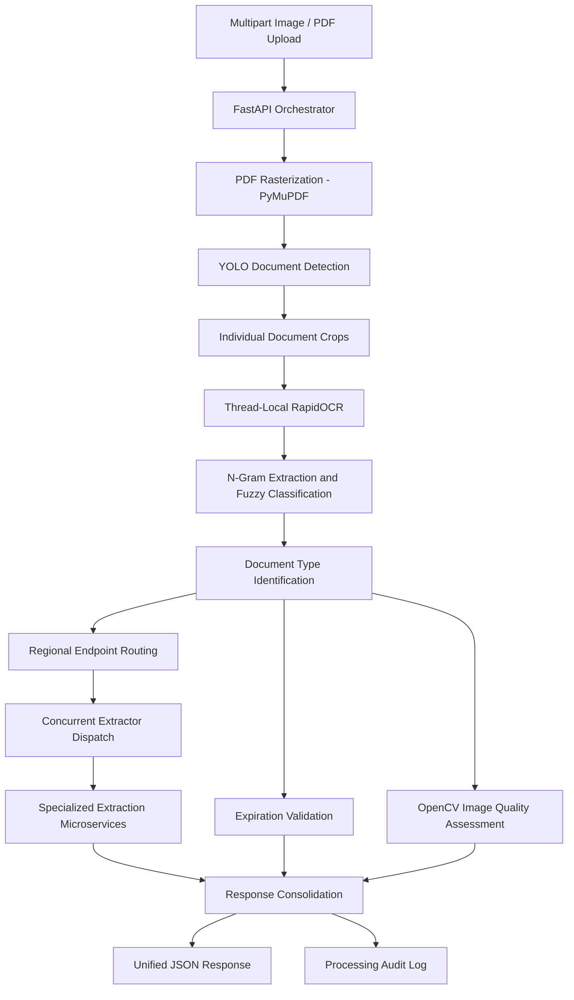

# Intelligent Claims Orchestrator – Multi-Document AI Processing Platform

An end-to-end document processing microservice that combines YOLO-based document detection, OCR, fuzzy classification, image quality assessment and concurrent microservice orchestration to automate multi-document motor insurance claim intake.

## 1. Project Overview

Motor insurance claim submissions frequently contain multiple documents in a single image or PDF. These may include identity cards, driving licenses, vehicle registrations and police reports, often with different orientations, image quality levels and document layouts.

Traditional workflows require users or operations teams to manually separate, categorize and submit individual documents to different extraction services.

This project introduces a unified FastAPI orchestration platform that automates the complete intake workflow, from document ingestion and segmentation to classification, quality inspection and downstream information extraction.

**Key objectives:**
- Accept mixed image and multi-page PDF submissions through a unified API.
- Detect and separate individual documents using YOLO.
- Classify document crops using OCR text and fuzzy keyword matching.
- Identify expired credentials and poor-quality uploads.
- Dispatch documents concurrently to specialized extraction services.
- Consolidate extraction results and validation information into a unified JSON response.

## 2. System Architecture

The platform follows a modular orchestration architecture in which specialized AI and image-processing components are coordinated through a central FastAPI service.

### Core Processing Components

1. **Document Ingestion:** Accepts multiple image and PDF files through a multipart API request.
2. **PDF Rasterization:** Uses PyMuPDF to convert PDF pages into image buffers for downstream processing.
3. **YOLO Document Detection:** Identifies individual document regions and generates crops from composite document images.
4. **Thread-Isolated OCR:** Uses thread-local RapidOCR instances to support parallel OCR execution without sharing the same OCR session across worker threads.
5. **Fuzzy Document Classification:** Extracts OCR n-grams and compares them against regional keyword configurations using RapidFuzz.
6. **Expiration Validation:** Identifies expiration dates and checks document validity.
7. **Image Quality Assessment:** Evaluates blur, brightness, contrast and image resolution using OpenCV.
8. **Concurrent Microservice Dispatch:** Routes classified document crops to specialized extraction services using a thread pool.
9. **Result Consolidation:** Combines extraction responses, quality indicators and validation results into a unified JSON response.

### End-to-End Workflow

1. Receive multipart image/PDF uploads, reference identifiers and regional processing parameters.
2. Convert multi-page PDFs into individual page images.
3. Apply YOLO document detection to composite images and isolate individual document regions.
4. Execute OCR using thread-local RapidOCR instances.
5. Generate text n-grams and match extracted content against regional classification configurations.
6. Identify document types and determine their corresponding extraction services.
7. Evaluate expiration dates and image quality indicators.
8. Dispatch individual document crops concurrently to downstream extraction APIs.
9. Collect responses and handle individual service failures.
10. Consolidate extracted fields, classification information, quality flags and validity indicators.
11. Return a structured JSON response and persist processing audit information.

### Architecture Diagram

## 3. Key Technical Contributions

### YOLO-Based Multi-Document Detection

Integrated a custom-trained YOLO document detection model to identify individual document regions within composite images.

- Implemented image-based document detection using Ultralytics YOLO.
- Configured detection parameters, including image size and confidence thresholds.
- Extracted bounding-box regions for downstream OCR and classification.
- Supported multi-page PDF processing through page-level rasterization.
- Implemented region-specific handling for document layouts that do not require the standard segmentation path.
- Added a police-report override mechanism to prevent fragmented YOLO detections from disrupting specialized police report extraction.

### Thread-Isolated OCR Execution

Designed a thread-local OCR session manager to address concurrency issues observed during parallel processing.

- Integrated RapidOCR using ONNX Runtime.
- Used Python's `threading.local()` to maintain OCR instances independently across worker threads.
- Avoided sharing a single OCR instance across concurrent processing tasks.
- Improved parallel execution reliability under the tested workload.
- Separated OCR initialization from individual document processing operations.

### Intelligent Document Classification

Implemented a regional keyword-based classification engine using OCR output.

- Generated unigram, bigram and trigram features from extracted text.
- Compared OCR content against regional JSON label definitions.
- Integrated RapidFuzz token-sort matching.
- Applied configurable classification thresholds.
- Supported regional classification configurations for UAE, Doha, Oman and Kuwait.

### Automated Image Quality Assessment

Developed OpenCV-based quality checks to identify unsuitable document images before downstream extraction.

| Quality Indicator | Assessment |
|---|---|
| Blur | Laplacian variance |
| Brightness | Mean pixel intensity |
| Contrast | Pixel intensity standard deviation |
| Resolution | Total pixel count |

Implemented configurable quality thresholds to flag documents that may require a new image capture.

### Concurrent Microservice Orchestration

Designed a concurrent dispatch mechanism to route identified documents to their corresponding specialized extraction services.

- Integrated Python `ThreadPoolExecutor`.
- Configured concurrent processing with up to 10 worker threads.
- Implemented environment-driven endpoint routing.
- Used HTTPX for downstream API communication.
- Configured connection and read timeouts.
- Consolidated responses from multiple extraction services.
- Added error-handling mechanisms for individual downstream processing failures.

### Unified Result Consolidation

Developed a centralized response mechanism to combine multiple processing outputs.

- Combined document classification and extraction results.
- Included image quality indicators and expiration validation results.
- Maintained reference-based processing information.
- Persisted processing details for audit and troubleshooting.

## 4. Technology Stack

| Category | Technologies |
|---|---|
| Programming Language | Python |
| Backend Framework | FastAPI, Uvicorn |
| Object Detection | Ultralytics YOLO, PyTorch |
| OCR | RapidOCR, ONNX Runtime |
| Cloud OCR | Azure AI Document Intelligence |
| Text Classification | RapidFuzz, N-Gram Processing |
| Image Processing | OpenCV, NumPy |
| PDF Processing | PyMuPDF |
| API Communication | HTTPX |
| Data Validation | Pydantic |
| Concurrency | Threading, ThreadPoolExecutor |
| Configuration | JSON, Environment Variables |
| Deployment | Nginx, Uvicorn |

## 5. Performance and Business Impact

- **Unified document intake:** Consolidated document splitting, classification, quality checks and extraction dispatch into a single API workflow.
- **Reduced manual processing:** Automated document separation and classification for composite image and multi-page PDF submissions.
- **Improved input quality control:** Identified potentially unreadable images before sending them to specialized extraction services.
- **Concurrent processing:** Enabled multiple document extraction requests to execute concurrently through a configurable worker pool.
- **OCR cost optimization:** Used local RapidOCR as the default processing path while retaining Azure OCR as an optional alternative. The reported cloud OCR expenditure reduction was over 80% in the measured operating context.
- **Operational integration:** Connected regional classification configurations with specialized downstream extraction microservices.

*Performance and cost figures depend on document volume, model execution environment, cloud OCR usage and deployment configuration. The reported cost reduction should be supported by comparable before-and-after usage data.*

## 6. Engineering Challenges

| Challenge | Engineering Solution |
|---|---|
| Composite images containing multiple documents | YOLO-based document detection and cropping |
| Multi-page PDF submissions | Page-level rasterization using PyMuPDF |
| Concurrent OCR execution issues | Thread-local RapidOCR instance management |
| Regional document variations | Configurable regional keyword classification |
| Police reports fragmented by object detection | Full-frame override for identified police reports |
| Poor image quality reaching extractors | Automated blur, brightness, contrast and resolution checks |
| Multiple downstream extraction services | Environment-driven routing and concurrent HTTP dispatch |
| Downstream API delays | Configurable connection and read timeouts |

## 7. Architectural Design Decisions

### Why YOLO?

A single uploaded image may contain multiple identity and vehicle documents. YOLO provides a document detection mechanism that identifies individual regions before OCR and classification.

This reduces the need for manual cropping and allows the processing pipeline to handle composite submissions.

### Why Thread-Local OCR?

Sharing one OCR session between multiple concurrent tasks caused reliability and throughput problems in the tested environment.

Thread-local storage provides each worker thread with its own OCR instance, reducing shared-instance contention.

### Why Concurrent Dispatching?

Different document types are handled by specialized extraction services.

Rather than waiting for every downstream request sequentially, the orchestrator dispatches independent extraction tasks concurrently and consolidates their results.

### Why Local RapidOCR with Optional Azure OCR?

Local OCR reduces dependence on external OCR API calls and can improve control over processing costs and data flow.

Azure Document Intelligence remains available for workflows where cloud OCR is preferred.

## 8. Project Highlights

- Unified multi-document motor claims processing.
- YOLO-based document detection and cropping.
- Multi-page PDF rasterization and processing.
- Thread-local RapidOCR execution.
- Regional fuzzy keyword classification.
- Automated expiration and image quality checks.
- Concurrent downstream microservice dispatch.
- Configurable API routing and timeout management.
- Consolidated JSON responses and processing audit information.
- Local and cloud OCR execution options.

## 9. Disclaimer

This repository describes the architecture, technical approach and engineering contributions. It does not include proprietary source code, production endpoints, internal routing configurations, customer documents, credentials or confidential insurance information.
