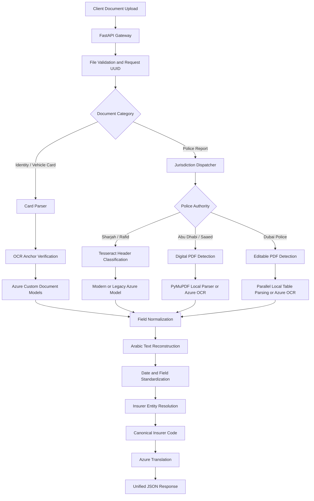

# UAE Motor Claims Intelligence – Multi-Jurisdiction Police Report & Document Extraction Platform

## 1. Project Overview

**Business Domain:** Motor Insurance | Claims Automation | Subrogation | Document Intelligence

This project implements a modular document intelligence platform for processing UAE motor insurance claim documents, with a focus on police accident reports issued by three jurisdictions:

- Sharjah Police (Rafid)
- Abu Dhabi (Saaed)
- Dubai Police

The platform also supports six standard identity and vehicle card layouts, covering front and back document variants.

Each police authority uses different document structures, terminology and formatting. The system combines jurisdiction-specific extraction logic, local PDF processing, OCR-based document classification and Azure AI Document Intelligence custom models to transform these documents into a unified enterprise JSON structure.

A key capability is automated insurer entity resolution. Free-text insurance company names extracted from police reports are matched against a master insurer registry to identify canonical insurer codes for downstream claims and subrogation workflows.

## 2. Architecture and Workflow

### Processing stages

1. **Request ingestion:** FastAPI receives multipart document uploads, validates the input and generates a request tracking UUID.

2. **Document routing:** The service identifies whether the uploaded document belongs to an identity/vehicle card workflow or a police report workflow.

3. **Identity and vehicle card processing:**
   - Routes documents to the dedicated card parser.
   - Uses OCR-derived anchor keywords to verify the expected document type.
   - Rejects mismatched uploads before invoking the relevant extraction model.
   - Passes verified documents to specialized Azure custom models.

4. **Sharjah police report processing:**
   - Rasterizes the top portion of the first page for local header analysis.
   - Uses Tesseract OCR to identify layout-specific keywords.
   - Selects the appropriate modern or legacy Sharjah extraction model.
   - Organizes extracted information by accident-party roles.

5. **Abu Dhabi police report processing:**
   - Checks whether the PDF contains extractable digital text.
   - Uses PyMuPDF for local parsing of supported editable reports.
   - Routes scanned reports to the Abu Dhabi Azure custom model.

6. **Dubai police report processing:**
   - Detects editable versus scanned PDF content.
   - Uses parallel parsing for supported digital party tables.
   - Applies local Tesseract pre-checks before invoking Azure extraction for scanned documents.

7. **Insurer entity resolution:**
   - Extracts the insurer name from the responsible party's information.
   - Compares the extracted name against a master insurer registry.
   - Uses RapidFuzz token-based similarity matching.
   - Resolves matching names to canonical insurer codes.

8. **Bilingual normalization and translation:**
   - Normalizes extracted dates.
   - Reconstructs Arabic text using bidirectional text handling.
   - Uses Azure Translator to generate English translations where required while retaining the original Arabic values.

9. **Quality gating and response generation:**
   - Checks that the extracted report contains sufficient non-empty information.
   - Produces a unified JSON response for downstream insurance systems.

## 3. Core Technical Contributions

### A. Multi-Jurisdiction Police Report Processing

Designed separate parsing modules for the three UAE police jurisdictions.

| Jurisdiction | Document type | Processing strategy |
|---|---|---|
| Sharjah | Rafid police reports | Local header classification and modern/legacy model selection |
| Abu Dhabi | Saaed police reports | Digital PDF extraction or Azure custom OCR |
| Dubai | Dubai Police reports | Editable PDF table parsing or Azure custom OCR |

This modular approach isolates jurisdiction-specific extraction logic while sharing common utilities for normalization, translation, validation and response generation.

**Engineering value:**
- Supports different police report formats through dedicated parsing strategies.
- Reduces dependence on a single extraction model.
- Allows individual jurisdiction parsers to evolve independently.
- Standardizes outputs across otherwise inconsistent source documents.

### B. Hybrid Local and Cloud Extraction

Implemented a routing strategy that uses local PDF extraction when the document contains usable digital text and reserves cloud-based neural extraction for scanned or more complex documents.

**Local processing:**
- PyMuPDF native text extraction.
- Coordinate-based table and party-profile parsing.
- Local Tesseract OCR for layout classification.
- Parallel processing of supported digital PDF structures.

**Cloud processing:**
- Azure AI Document Intelligence custom neural models.
- Separate extraction configurations for jurisdiction-specific layouts and document categories.
- Azure Translator for bilingual normalization.

This design reduces unnecessary cloud OCR calls without removing the ability to process scanned documents.

### C. Automated Insurer Entity Resolution

Developed a fuzzy entity-resolution mechanism to map free-text insurance company names to canonical records in a master insurer registry.

The implementation uses:
- RapidFuzz `token_sort_ratio`.
- RapidFuzz `token_set_ratio`.
- Configured similarity thresholds.
- A master registry containing 42 insurer records.
- Canonical insurer codes for downstream integration.

**Example:**

A recognized insurer name extracted from a police report can be resolved to its corresponding canonical registry code.

This converts unstandardized text into a structured business identifier, supporting downstream insurer identification and subrogation workflows.

The matching score is a candidate-selection signal; ambiguous matches should be validated rather than automatically treated as confirmed entities.

### D. Automatic Sharjah Report Layout Classification

Implemented local Tesseract-based header analysis to distinguish between modern and legacy Sharjah police report layouts.

The classifier examines layout-specific keywords and selects the corresponding Azure extraction model.

This removes the need for users or upstream systems to manually select the report version.

### E. Arabic Text Reconstruction and Bilingual Normalization

Implemented Arabic text handling using:
- `arabic-reshaper`
- `python-bidi`
- Coordinate-based word ordering
- Date normalization
- Azure Translator

For Arabic police reports, word positions and text direction must be handled carefully to reconstruct meaningful field values.

Developed spatial polygon ordering logic to organize words in the correct right-to-left reading sequence within line groups.

### F. Document-Type Verification for Card Extraction

Implemented an anchor-verification mechanism for identity and vehicle card endpoints.

The system checks OCR-derived keywords associated with the expected document type before sending the document to a specialized extraction model.

This provides an early validation layer for incorrect uploads, such as a passport submitted to a driving-license endpoint.

## 4. Technology Stack

| Category | Technologies |
|---|---|
| Programming Language | Python 3.11+ |
| API Framework | FastAPI, Uvicorn |
| PDF Processing | PyMuPDF |
| OCR | Tesseract OCR |
| Cloud Document AI | Azure AI Document Intelligence |
| Translation | Azure AI Translator |
| Text Matching | RapidFuzz |
| Image Processing | OpenCV, NumPy |
| Arabic Processing | arabic-reshaper, python-bidi |
| Date Processing | python-dateutil |
| Data Validation | Pydantic |
| Concurrency | AnyIO, ThreadPoolExecutor |
| Configuration | JSON-based insurer registry |
| Deployment | Docker, Python 3.11-slim |
| Logging | Python RotatingFileHandler |

## 5. Engineering Challenges and Design Decisions

| Challenge | Engineering approach |
|---|---|
| Three different police report layouts | Dedicated jurisdiction-specific parsers |
| Legacy and modern Sharjah reports | Tesseract-based header classification |
| High OCR costs for digital PDFs | Local PyMuPDF extraction bypass |
| Large digital PDF party tables | Parallel parsing of supported tables |
| Free-text insurer names | Fuzzy entity resolution against a master registry |
| Arabic right-to-left text ordering | Spatial polygon sorting and RTL normalization |
| Incorrect card uploads | OCR anchor verification and request rejection |
| Inconsistent document outputs | Unified enterprise JSON schema |

### Architectural trade-offs

- **Hybrid cloud and local processing:** Reduces unnecessary cloud calls, but requires maintaining both local parsing and cloud model integrations.
- **Fuzzy insurer matching:** Handles spelling and formatting variations, but can produce ambiguous candidates when insurer names are similar.
- **Jurisdiction-specific parsers:** Improve control over known document formats, but require maintenance as government document templates change.
- **Parallel PDF processing:** Can reduce processing time for supported workloads, but requires appropriate worker and memory limits.
- **Translation:** Improves downstream accessibility, but translated values should not replace original source text for audit-sensitive fields.

## 6. Performance and Business Impact

### Reported project outcomes

- **Digital PDF extraction:** Accident claim processing was reported to complete in under five seconds for supported digital police reports.
- **Cloud OCR optimization:** Local PDF extraction reduced cloud API usage by more than 70% in the reported workload.
- **Automatic layout routing:** Sharjah report classification removed the need for manual selection between modern and legacy layouts.
- **Insurer identification:** Automated entity resolution connected extracted insurer names to canonical registry codes.
- **Unified output:** Three police jurisdictions and multiple card layouts were mapped into standardized enterprise JSON structures.

These are project-reported results and should be supported by representative evaluation data before being presented as generalized production guarantees.

### Business applications

- Motor accident claim registration.
- Police report information extraction.
- Liable and affected party identification.
- Insurer identification for subrogation workflows.
- Identity and vehicle document processing.
- Bilingual claims-handler support.
- Integration with downstream insurance systems.

## 7. Key Skills Demonstrated

- Enterprise Document AI architecture
- Multi-jurisdiction document processing
- FastAPI microservice engineering
- Hybrid local and cloud inference
- Azure AI Document Intelligence integration
- PDF structure analysis and native text extraction
- OCR-based layout classification
- Fuzzy entity resolution and record linkage
- Arabic-English document processing
- Spatial text reconstruction
- Parallel processing and concurrency
- Docker-based deployment
- API validation and operational logging

## 8. Project Scope and Disclaimer

This repository documents the system architecture and engineering approach. It excludes proprietary source code, internal Azure model identifiers, customer information, police reports, insurer registry contents, API credentials and confidential infrastructure details.

The platform supports automated document extraction and insurer matching for claims workflows. Extracted information and entity-resolution results should be validated before being used for official claims, liability or subrogation decisions.

Production use requires appropriate controls for personal data, API security, model governance, translation accuracy, auditability, monitoring and changes to government document formats.
