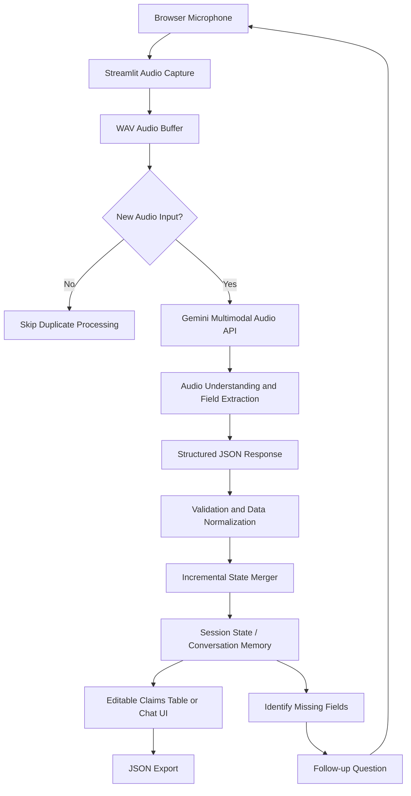

# Multilingual Voice Intelligence – Conversational Motor Claims Extraction Platform

## 1. Project Overview

**Project Domain:** Motor Insurance | Multimodal Generative AI | Conversational AI

This project explores a voice-first approach to motor insurance claim intake. Instead of requiring policyholders to manually enter multiple fields into a digital form, the system allows them to communicate claim information through spoken audio.

Built using Streamlit and Google Gemini multimodal audio models, the platform processes microphone recordings directly and converts spoken information into structured claim attributes. It supports both single-pass extraction and multi-turn conversational data collection.

The solution consists of two applications:

- **Structured Voice Extraction (`app.py`):** Extracts claim attributes from individual audio submissions and incrementally updates an editable data table.
- **Conversational Voice Collection (`chat_interaction.py`):** Maintains conversational context, identifies missing claim information, and asks follow-up questions until the required fields are collected.

## 2. Architecture and Workflow

### Processing stages

1. **Audio ingestion:** Captures claimant speech through Streamlit's browser microphone input and receives WAV audio bytes.
2. **Duplicate input prevention:** Compares the incoming audio bytes with the previously processed input stored in `st.session_state`, avoiding unnecessary API calls during reactive Streamlit reruns.
3. **Multimodal inference:** Sends audio bytes and extraction instructions to Google Gemini through the `google-genai` SDK.
4. **Structured extraction:** Uses prompt instructions and JSON output constraints to extract claim information directly from audio without requiring a separate speech-to-text service.
5. **Incremental data merging:** Updates fields containing newly extracted values while retaining previously captured information when a field is absent or empty.
6. **Conversational collection:** Uses accumulated claim memory to identify missing mandatory attributes and generate relevant follow-up questions.
7. **Review and export:** Presents extracted information in an editable table or conversational interface and supports JSON output.

## 3. Core Technical Contributions

### A. Direct Multimodal Audio Processing

Implemented an audio-to-structured-data workflow using Gemini's multimodal audio capabilities.

Rather than implementing separate speech transcription and text extraction services, the application sends audio directly to the model with task-specific instructions.

**Engineering value:**
- Simplifies the processing architecture.
- Reduces the need for a separate transcription component.
- Enables contextual interpretation of spoken claim information.
- Supports multilingual voice input, subject to the model's language capabilities.

### B. Schema-Guided Information Extraction

Designed prompts around a structured motor claims schema containing 13 attributes, including:

- Driver name
- Vehicle registration number
- Chassis number
- Accident date
- Accident-related information
- Other mandatory claim attributes

Implemented structured JSON decoding and field-level updates to make the model response usable by downstream application components.

### C. Conversational State Management

Developed a multi-turn dialogue workflow that maintains previously collected information across user interactions.

The assistant:
- Tracks populated and missing claim fields.
- Uses accumulated conversation memory in subsequent prompts.
- Asks follow-up questions for missing mandatory information.
- Merges newly supplied information without unnecessarily clearing existing values.
- Uses a completion indicator to identify when the required information has been collected.

### D. Reactive UI and Audio Deduplication

Addressed Streamlit's reactive execution model, where widget interactions can trigger application reruns.

Implemented an audio-byte comparison mechanism using session state to prevent repeated processing of the same audio submission.

This reduces unnecessary inference requests and helps control API usage.

## 4. Technology Stack

| Category | Technologies |
|---|---|
| Language | Python 3.10+ |
| UI and Application | Streamlit |
| Generative AI | Google Gemini multimodal audio models |
| AI Integration | Google GenAI SDK |
| Data Processing | Pandas |
| Data Validation | Pydantic |
| State Management | Streamlit Session State |
| Data Exchange | JSON |
| Development | VS Code, Git |

**Models explored:**
- `gemini-3.1-flash-lite-preview`
- `gemini-2.0-flash-lite`

## 5. Business Applications

The architecture is applicable to:

- Motor accident claim intimation.
- Voice-assisted insurance form completion.
- Multilingual customer onboarding.
- Hands-free claim information collection.
- Conversational digital insurance assistants.

By allowing customers to communicate naturally instead of manually completing long forms, the system offers a potential improvement in accessibility and claim intake efficiency.

## 6. Engineering Challenges and Design Decisions

| Challenge | Engineering approach |
|---|---|
| Repeated Streamlit executions | Audio-byte comparison using session state |
| Unstructured spoken information | Schema-guided Gemini prompts |
| Incomplete claim submissions | Multi-turn missing-field collection |
| Corrections across multiple utterances | Incremental, non-destructive state merging |
| Unnecessary transcription stages | Direct multimodal audio processing |
| Human review requirements | Editable structured output |

### Architectural trade-offs

- **Direct audio inference:** Simplifies the pipeline, but depends on model audio capabilities, API availability, latency and cost.
- **In-memory state:** Makes the prototype lightweight, but session state is not a persistent, durable claim database.
- **LLM-based extraction:** Provides flexible language understanding, but extracted fields still require validation and user confirmation.
- **Single-service application:** Enables rapid development, but production deployment would require additional security, observability and reliability controls.

## 7. Business Impact and Value

The project demonstrates a potential reduction in claim-intake friction through voice-based data collection.

Reported project target or outcome:
- Manual claim entry: approximately 15 minutes.
- Voice-based collection: under 2 minutes.

These figures should be presented as measured results only if supported by comparable end-to-end timing tests. Otherwise, they should be treated as a target or prototype estimate.

Other potential benefits include:
- Better accessibility for customers who prefer speaking over typing.
- Support for Arabic, English, Hindi and Urdu, subject to language and dialect testing.
- Faster prototyping of conversational insurance intake workflows.
- Reduced dependence on manually completed digital forms.

## 8. Key Skills Demonstrated

- Multimodal Generative AI
- Audio understanding and information extraction
- Prompt engineering and structured JSON generation
- Conversational AI and dialogue state tracking
- Multilingual NLP
- Incremental data merging
- Streamlit application engineering
- Human-in-the-loop data validation
- API integration and inference optimization

## 9. Project Scope and Disclaimer

This repository documents an engineering implementation and its architecture. It does not include proprietary insurance data, internal customer records, private API credentials or confidential company code.

The system is intended as an AI-assisted claim-intake prototype. Extracted information should be reviewed and confirmed by the claimant or an authorized claims representative before being treated as an official insurance submission.

Production deployment would require additional assessment of data privacy, audio retention, authentication, API security, consent, reliability and regulatory requirements.
