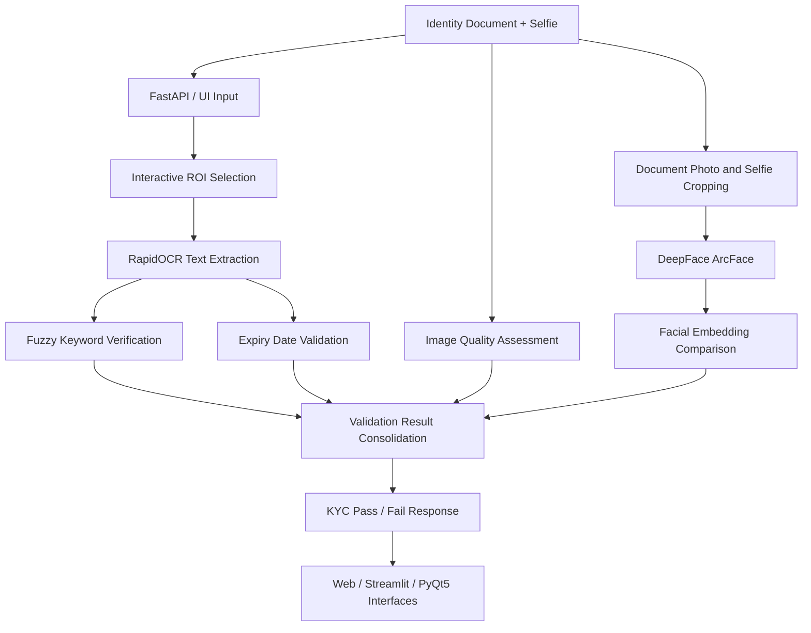

# Multimodal KYC Intelligence – AI-Powered Identity Verification Platform

A multimodal identity verification platform combining OCR, fuzzy text matching, document validity checks, image quality assessment and deep learning-based facial recognition to automate KYC document validation.

## 1. Project Overview

Financial institutions and insurance providers require reliable identity verification during customer onboarding to reduce impersonation, fraudulent applications and invalid document submissions.

Traditional document validation systems often rely on isolated OCR or manual verification processes, making it difficult to assess document authenticity, expiration status, image quality and applicant identity together.

This project introduces a unified KYC validation architecture that combines document analysis, rule-based verification and facial biometrics into a single workflow.

The platform supports identity document verification through multiple validation stages and provides different user interfaces for operational and branch-level use cases.

**Key objectives:**
- Automate identity document validation.
- Detect expired or invalid identity documents.
- Verify document text against jurisdiction-specific keywords.
- Assess document image quality before accepting submissions.
- Compare identity document photographs with customer selfies.
- Provide a consolidated KYC verification result through multiple interfaces.

## 2. Architecture

The platform follows a multimodal validation architecture combining OCR, rule-based processing, image analysis and facial biometric verification.

### Five Validation Components

1. **Document Keyword Verification:** Extracts text using RapidOCR and validates expected document identifiers using fuzzy matching.
2. **Expiration Date Validation:** Identifies document expiry dates and checks whether credentials are still valid.
3. **Image Quality Assessment:** Evaluates image resolution, contrast and sharpness to identify unsuitable uploads.
4. **Facial Biometric Verification:** Uses DeepFace with ArcFace to compare the identity document photograph with a customer selfie.
5. **Interactive Region-of-Interest Extraction:** Allows operators to select specific document regions for targeted field extraction and verification.

### Processing Workflow

1. Receive identity document images and selfie captures through the user interface.
2. Allow operators to select relevant document regions through an interactive ROI interface.
3. Extract document text using RapidOCR.
4. Apply fuzzy keyword matching against expected jurisdictional identifiers.
5. Parse expiry dates and validate document validity.
6. Evaluate image resolution, contrast and sharpness.
7. Extract facial representations from the document photograph and customer selfie.
8. Compare facial embeddings using a configured similarity metric and verification threshold.
9. Consolidate validation outcomes into a structured KYC response.
10. Display the verification results through web, dashboard or desktop interfaces.

### Architecture Diagram

## 3. Key Technical Contributions

### Multimodal KYC Validation Engine
- Designed a unified validation workflow combining OCR, fuzzy text matching, date verification, image quality assessment and facial biometrics.
- Implemented independent validation components to evaluate different aspects of identity documents.
- Consolidated individual validation results into a structured KYC verification response.

### OCR and Fuzzy Text Verification
- Integrated RapidOCR for document text detection and recognition.
- Implemented fuzzy matching using RapidFuzz to validate jurisdiction-specific keywords.
- Developed configurable matching thresholds to accommodate OCR variations and imperfect document captures.
- Supported targeted text extraction from selected document regions.

### Document Expiration Validation
- Implemented regular-expression-based date extraction.
- Supported multiple date formats, including `DD-MM-YYYY` and `DD/MM/YYYY`.
- Compared extracted expiration dates against the current date to identify expired documents.
- Integrated validity results into the overall verification workflow.

### Image Quality Assessment
- Implemented image resolution and dimension checks.
- Analyzed image contrast and sharpness to identify low-quality document captures.
- Applied image preprocessing to improve downstream text and biometric verification.

### Deep Learning-Based Facial Verification
- Integrated DeepFace with the ArcFace facial recognition model.
- Generated facial embeddings from identity document photographs and customer selfies.
- Implemented embedding comparison using cosine distance.
- Evaluated different facial recognition backends to select an appropriate verification approach.
- Applied image preprocessing and face alignment to improve matching on low-resolution identity photographs.

### Multi-Platform Application Development
- Developed a browser-based interface using Jinja2, HTML5, JavaScript and interactive canvas-based ROI selection.
- Created a Streamlit dashboard for operational document verification.
- Developed a PyQt5 desktop application for workstation-based verification workflows.
- Integrated application interfaces with the underlying verification services.

## 4. Technology Stack

| Category | Technologies |
|---|---|
| Language | Python, JavaScript |
| Backend | FastAPI, Uvicorn |
| OCR | RapidOCR, ONNX Runtime |
| Facial Recognition | DeepFace, ArcFace |
| Computer Vision | OpenCV, Pillow, NumPy |
| Text Matching | RapidFuzz, Regular Expressions |
| Web Interface | HTML5, CSS3, JavaScript, Jinja2 |
| Dashboard | Streamlit |
| Desktop Application | PyQt5 |
| API Testing | Swagger UI, Postman |

## 5. Performance and Business Impact

- **Unified verification:** Combined multiple identity validation mechanisms into a single processing workflow.
- **Biometric verification:** Enabled automated facial comparison between identity document photographs and customer selfies.
- **Improved document screening:** Identified expired credentials, missing identifiers and low-quality image submissions.
- **Multi-platform accessibility:** Provided browser, dashboard and desktop interfaces backed by a shared verification workflow.
- **Operational automation:** Reduced dependence on disconnected manual identity verification steps.

*Note: Fraud reduction and regulatory compliance should be treated as intended business outcomes unless supported by measured results and formal compliance validation.*

## 6. Engineering Challenges

| Challenge | Solution |
|---|---|
| OCR variations in identity documents | Implemented fuzzy keyword matching |
| Multiple expiry date formats | Developed configurable date parsing and validation |
| Low-resolution ID photographs | Applied image preprocessing and face alignment |
| Facial recognition false rejections | Evaluated alternative face recognition backends and selected ArcFace |
| Different operational user requirements | Developed browser, Streamlit and PyQt5 interfaces |
| Large or irrelevant document regions | Added interactive ROI-based extraction |

## 7. Architectural Design Decisions

### Why Multimodal Validation?

A single OCR result cannot establish whether an identity document is valid or whether the person presenting it matches the document photograph.

The platform combines different verification mechanisms to evaluate textual, temporal, visual and biometric information independently.

### Why ArcFace?

ArcFace generates discriminative facial embeddings designed for facial recognition and verification tasks.

The system compares embeddings from the document photograph and customer selfie using cosine distance and applies a configured verification threshold.

### Why Multiple Interfaces?

Different operational environments have different interaction requirements.

- **Web interface:** Interactive document inspection and ROI selection.
- **Streamlit:** Rapid operational testing and verification dashboards.
- **PyQt5:** Desktop-based workflows for branch environments.

## 8. Project Highlights

- Multimodal KYC document validation architecture.
- OCR-driven document keyword verification.
- Automated expiration date validation.
- Image quality and resolution assessment.
- ArcFace-based facial biometric verification.
- Interactive document ROI selection.
- Web, Streamlit and desktop application interfaces.

## 9. Disclaimer

This repository documents the project's architecture, technical approach and engineering contributions. It does not contain proprietary source code, actual identity documents, biometric data, customer selfies, credentials or confidential business information.
