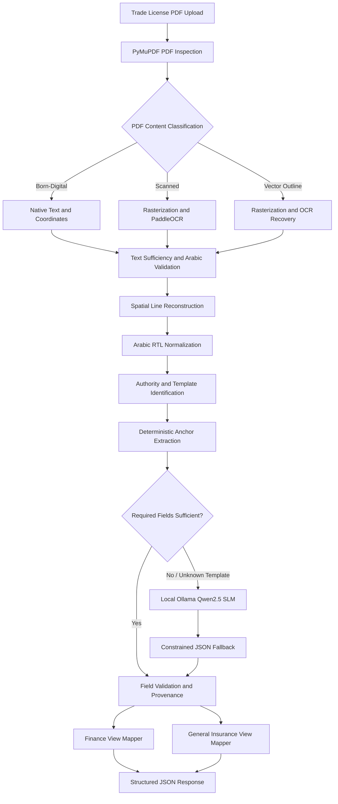

# UAE Trade License Intelligence – Hybrid CPU-Based Document Extraction Engine

## 1. Project Overview

**Business Domain:** Commercial Insurance | Corporate Underwriting | Document Intelligence

This project implements a hybrid, CPU-optimized document extraction platform for UAE commercial trade licenses issued by multiple government and free-zone authorities.

Trade licenses present several document-processing challenges, including bilingual Arabic-English content, inconsistent layouts, complex tables, scanned pages and vector-outline PDFs that may contain no extractable text.

The solution combines native PDF text extraction, selective OCR, deterministic spatial extraction rules and a locally hosted Small Language Model (SLM) fallback.

Rather than relying entirely on cloud OCR or generative AI, the system prioritizes fast and explainable extraction methods, invoking more computationally expensive components only when required.

The extracted information is transformed into two business-specific output schemas:

- **Finance View:** Billing entities, issuing authorities, license categories and business activities.
- **General Insurance View:** Commercial registration identifiers, company identity and contact information.

The implementation covers nine known UAE trade license authority templates.

## 2. Architecture and Workflow

### Processing stages

1. **PDF ingestion and inspection:** Receives a trade license PDF and inspects its text content, character availability, fonts and vector information using PyMuPDF.

2. **Document-type classification:** Identifies whether the PDF contains extractable digital text, rasterized scanned content or vector-outline content requiring OCR recovery.

3. **Selective text extraction:**
   - **Digital PDF path:** Extracts native text and word-level bounding boxes using PyMuPDF.
   - **Scanned PDF path:** Rasterizes pages and invokes PaddleOCR.
   - **Vector-outline path:** Detects insufficient extractable text and triggers rasterization and OCR rather than relying on native text extraction.

4. **Spatial line reconstruction:** Groups extracted words using their bounding-box coordinates to reconstruct logical text lines and preserve document layout.

5. **Arabic text normalization:** Applies Arabic reshaping and bidirectional text handling to improve the representation and processing of bilingual document content.

6. **Authority identification and template routing:** Identifies the issuing authority and routes the document through deterministic extraction rules for the nine supported templates.

7. **Anchor-based field extraction:** Uses spatial relationships, label anchors and regular-expression patterns to extract relevant business and license attributes.

8. **Local SLM fallback:** Uses a locally hosted quantized Qwen2.5 3B Instruct model through Ollama when an unfamiliar layout or insufficiently resolved field requires contextual interpretation.

9. **Field validation and provenance:** Associates extracted values with source information, including page references, bounding boxes, extraction methods and confidence information where available.

10. **Business schema transformation:** Converts the extracted information into separate Finance and General Insurance response structures.

## 3. Core Technical Contributions

### A. Hybrid PDF Processing Architecture

Designed a multi-path PDF processing engine that selects an extraction strategy based on the underlying document representation.

| PDF type | Processing strategy |
|---|---|
| Born-digital PDF | Native text extraction using PyMuPDF |
| Raster scan | Page rasterization followed by PaddleOCR |
| Vector-outline PDF | Rasterization and OCR recovery |

This selective processing approach avoids running OCR unnecessarily on documents that already contain extractable text.

**Engineering value:**
- Reduces unnecessary OCR execution.
- Preserves native text coordinates when available.
- Supports documents with missing or unusable font information.
- Provides a fallback path for visually populated PDFs with little or no extractable text.

### B. Spatial and Anchor-Based Extraction

Developed deterministic extraction logic for nine known UAE authority layouts.

The extraction engine uses:
- Word-level bounding-box coordinates.
- Vertical coordinate alignment for line reconstruction.
- Label and value relationships.
- Authority-specific layout rules.
- Regular-expression-based field identification.
- Negative-label guards for ambiguous identifiers.

This is particularly important for trade licenses where several registration and membership identifiers may appear close together.

For example, explicit negative-label rules help prevent a Chamber of Commerce or DCCI number from being incorrectly interpreted as a Commercial Register number.

### C. Vector-Outline PDF Recovery

Addressed a challenging PDF representation in which visible document content is represented through vector drawing paths rather than embedded text.

A PDF may therefore render correctly while returning little or no usable text through ordinary text extraction.

Implemented a recovery mechanism that:
1. Inspects native text availability and PDF characteristics.
2. Identifies pages with insufficient extractable text.
3. Rasterizes the affected content.
4. Invokes OCR to recover the visible text.

This avoids treating every empty text extraction result as an empty document.

### D. Arabic-English Document Normalization

Implemented Arabic text handling using:

- `arabic-reshaper`
- `python-bidi`

Combined with coordinate-based line reconstruction, this supports more consistent processing of bilingual trade license content.

The approach is designed to preserve the relationship between Arabic and English labels and values during extraction and normalization.

### E. Local SLM Fallback

Integrated a locally hosted Qwen2.5 3B Instruct model through Ollama.

The model receives reconstructed text rather than relying on direct image understanding.

Its role is to handle cases where deterministic extraction rules cannot sufficiently resolve a field or an unfamiliar document layout is encountered.

**Design principle:** Deterministic extraction remains the primary path; the SLM acts as a fallback rather than the default extraction engine.

Constrained JSON output and explicit field instructions help produce responses that can be validated and mapped into the target business schemas.

### F. Dual Business Schema Transformation

Implemented two dedicated output mapping functions:

- `finance_view()`
- `gi_view()`

These functions transform a common extraction result into different business-oriented representations.

This separates document understanding from downstream business requirements and allows multiple internal consumers to use the same extraction pipeline.

## 4. Technology Stack

| Category | Technologies |
|---|---|
| Programming Language | Python 3.10+ |
| API Framework | FastAPI |
| PDF Processing | PyMuPDF |
| OCR | PaddleOCR, Tesseract |
| Computer Vision | OpenCV |
| Local Generative AI | Ollama, Qwen2.5 3B Instruct |
| Text Matching | RapidFuzz |
| Arabic Processing | arabic-reshaper, python-bidi |
| Date Normalization | dateparser |
| Data Processing | Pandas |
| API Communication | HTTPX |
| Data Validation | Pydantic |
| Embedding Experiments | fastembed, multilingual MiniLM |
| Runtime | Local CPU inference |

## 5. Performance and Evaluation

The implementation was evaluated against a document corpus containing the supported trade license layouts.

| Processing path | Reported execution time |
|---|---:|
| Native digital PDF extraction | 65–130 ms |
| Full OCR scan processing | 6–10.7 seconds |
| Experimental RAG extraction | Approximately 45 seconds |

These are reported project evaluation results, not universal performance guarantees. Actual latency depends on document complexity, page count, hardware, OCR execution and whether the SLM fallback is invoked.

### Evaluation considerations

- Digital PDF extraction benefits from avoiding unnecessary OCR.
- Scanned and vector-outline documents require rasterization and OCR.
- The deterministic approach avoids invoking the SLM for every document.
- The experimental RAG approach introduced additional CPU latency and was not selected for the primary extraction workflow.

## 6. Engineering Challenges and Design Decisions

| Challenge | Engineering approach |
|---|---|
| PDFs with no usable embedded text | Vector-outline detection and OCR recovery |
| Different government authority layouts | Nine authority-specific extraction templates |
| Arabic-English text alignment | Spatial line reconstruction and RTL handling |
| Ambiguous registration identifiers | Negative-label guards and contextual extraction rules |
| Inconsistent field placement | Coordinate-based anchor extraction |
| Unknown document layouts | Local SLM fallback |
| CPU resource constraints | Selective OCR and deterministic-first processing |
| Different business data requirements | Separate Finance and General Insurance schema mappers |

### Experimental RAG evaluation

An experimental retrieval-augmented extraction approach was evaluated using BM25 and semantic embeddings.

The implementation used:
- BM25 retrieval.
- Multilingual sentence embeddings.
- `fastembed` ONNX inference.
- Context-based extraction experiments.

The observed processing latency was approximately 45 seconds on the tested CPU environment.

The deterministic anchor-based approach was retained as the primary pipeline because it provided a more suitable latency profile for the supported, known authority templates.

This is an important architectural decision: a more sophisticated AI component is not necessarily the best production choice when a simpler, explainable method meets the business requirement.

## 7. Business Applications and Value

The platform is designed to support commercial insurance and corporate onboarding workflows involving UAE trade licenses.

Potential applications include:

- Corporate customer onboarding.
- Commercial policy issuance.
- Trade license verification workflows.
- Finance and billing entity identification.
- General Insurance underwriting data preparation.
- Automated document intake and extraction.

### Reported project outcomes

- **Processing speed:** Digital extraction completed in approximately 65–130 ms in the tested environment.
- **OCR processing:** Full scanned-document extraction completed in approximately 6–10.7 seconds in the tested evaluation.
- **Automated extraction:** 100% automated extraction was reported across the evaluation corpus.
- **Cloud dependency:** The primary extraction architecture uses local PDF processing, OCR and SLM inference without requiring a cloud OCR API.
- **Field traceability:** Extracted values can be associated with source pages, bounding boxes, extraction methods and confidence information.

The reported 100% result applies to the evaluated corpus and should not be interpreted as guaranteed accuracy across all UAE trade licenses.

## 8. Key Skills Demonstrated

- Hybrid Document AI architecture
- Deterministic information extraction
- PDF structure inspection and recovery
- Computer vision and OCR integration
- Spatial coordinate-based extraction
- Arabic-English document processing
- Local SLM deployment and integration
- Prompt engineering and structured JSON generation
- CPU inference optimization
- Business schema transformation
- Field-level provenance and traceability
- FastAPI service development
- Evaluation-driven architecture selection

## 9. Project Scope and Disclaimer

This repository documents the engineering architecture and technical approach. It does not contain proprietary company source code, internal trade license documents, customer records, credentials or confidential infrastructure information.

The extraction system is designed to assist corporate onboarding, finance and underwriting workflows. Extracted values should be validated against their source documents before being used for official legal, financial or insurance decisions.

Production use requires appropriate testing across authority-specific document variations, data security controls, monitoring, model governance and operational validation.
