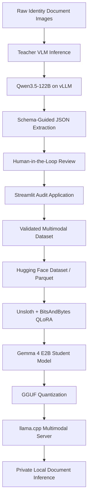

# Private VLM Distillation & Edge Deployment – QLoRA Fine-Tuning Pipeline

## 1. Project Overview

This project implements an end-to-end vision-language model (VLM) development lifecycle for extracting structured information from regional identity documents.

The objective was to develop a compact, locally deployable multimodal model that can process Arabic-English bilingual identity cards while reducing dependence on recurring commercial OCR and cloud-based multimodal inference services.

The pipeline combines large-model teacher inference, human-in-the-loop dataset validation, multimodal dataset engineering, parameter-efficient fine-tuning, model quantization, and private inference serving.

**Core objective:** Use a high-capacity teacher VLM to generate candidate document extractions, validate those outputs through human review, and fine-tune a smaller multimodal student model for domain-specific structured information extraction.

### Key capabilities

- Teacher-generated training data using a high-capacity VLM.
- Human-in-the-loop review and correction of extracted fields.
- Multimodal conversational dataset construction.
- 4-bit QLoRA fine-tuning using Unsloth and BitsAndBytes.
- Catastrophic memorization and visual-grounding failure analysis.
- GGUF quantization and local multimodal inference using llama.cpp.
- Structured JSON extraction for regional identity document categories.

## 2. Architecture

The solution follows a five-stage model development lifecycle.



### Stage 1 – Teacher Model Inference

A high-capacity teacher model was deployed using vLLM to generate candidate structured extractions from regional identity card images.

**Teacher model:** Qwen3.5-122B-A10B-GPTQ-Int4

Key implementation details:

- Processed more than 553 document card images during the initial inference run.
- Used Pydantic-defined output structures to constrain the expected extraction format.
- Applied JSON-schema-guided decoding to generate structured responses.
- Recorded extraction outputs for subsequent dataset inspection and correction.

**Initial benchmark:**

| Metric | Reported result |
|---|---:|
| Images processed | 553+ |
| Total inference time | 18 minutes |
| Average time per image | 2.03 seconds |
| Initial prediction error rate | Approximately 40% |

The initial audit revealed errors such as date-format ambiguity, duplicated records, numeric-field contamination, and incorrect Arabic text extraction. These outputs were not treated as trusted ground truth.

### Stage 2 – Human-in-the-Loop Dataset Validation

A Streamlit-based review application (`demo.py`) was developed to inspect and correct teacher-generated extraction records before fine-tuning.

**Dataset reviewed:**
- UAE records: 664
- Doha records: 296
- Total: 960 records

The review application included:

- Side-by-side document image and extracted-field display.
- Dynamic input fields for correcting extracted values.
- Live difference tracking between original and corrected values.
- Automatic saving during navigation.
- Reviewer provenance through `edited_by` and `edited_fields`.
- Record-level validation and review tracking.

This stage established a human-verified dataset rather than relying directly on noisy teacher-generated predictions.

### Stage 3 – Multimodal Dataset Engineering

Validated records were transformed into conversational training examples compatible with the Unsloth fine-tuning workflow.

Key implementation details:

- Converted records into structured `messages` format.
- Associated document images with corresponding user prompts.
- Used structured JSON assistant responses as target completions.
- Created stratified 85% training and 15% validation splits.
- Serialized the dataset into Parquet shards.
- Published versioned dataset artifacts to Hugging Face Hub.

Dataset reference: `Peterleo5/uae-ocr-test`

The resulting dataset was designed to teach the student model to map regional identity document images to consistent structured extraction outputs.

### Stage 4 – 4-Bit QLoRA Fine-Tuning

The compact student model was fine-tuned using Unsloth, PyTorch, Transformers, TRL, and BitsAndBytes.

**Student model:** Google Gemma 4 E2B

**Fine-tuning configuration:**

| Parameter | Configuration |
|---|---|
| Fine-tuning framework | Unsloth |
| Quantization | 4-bit BitsAndBytes |
| Adaptation method | QLoRA |
| LoRA rank | 16 |
| LoRA alpha | 16 |
| Target modules | Attention and MLP linear projections |
| Optimizer | 8-bit AdamW |
| Vision-layer fine-tuning | Disabled in revised configuration |
| Training objective | Assistant completion training |

The LoRA adapters targeted the attention projections (`q`, `k`, `v`, `o`) and MLP projections (`gate`, `up`, `down_proj`).

#### Catastrophic Memorization Investigation

The initial training experiment exposed a serious generalization problem: the student model reproduced memorized training examples instead of reliably grounding its output in the supplied document image.

A forensic investigation was performed using the training configuration, dataset structure, and failure reports.

The investigation identified issues involving dataset mapping and multimodal training configuration.

The revised training recipe introduced:

- Explicit dataset-format validation.
- A consistent six-schema catalog prompt.
- `train_on_completions: true` to focus optimization on assistant responses.
- `finetune_vision_layers: false` to preserve the pretrained visual components.
- Revised data mapping and training configuration.

These changes were intended to improve visual grounding, reduce memorization, and preserve compatibility with the model's multimodal inference components.

### Stage 5 – GGUF Quantization and Private Deployment

After fine-tuning, the student model was exported into a quantized GGUF artifact for local inference.

**Deployment components:**

- GGUF model artifact: `gemma-4-E2B-it-Q4_K_S.gguf`
- Multimodal projection component: `mmproj`
- Local inference runtime: llama.cpp
- Serving interface: Local HTTP inference server
- Configured service port: `8000`

The deployment separates the quantized model weights from the multimodal projection component required for image-based inference.

This enables document images to be processed within the private deployment environment without requiring an external commercial OCR inference API for the supported document classes.

## 3. Human-in-the-Loop Review Application

The Streamlit review application was an important part of the model development workflow.

Rather than allowing noisy teacher predictions to become training labels, the application provided a controlled review process.

**Main capabilities:**

1. Load document images and their corresponding teacher-generated predictions.
2. Display the original image alongside extracted values.
3. Allow reviewers to correct individual fields.
4. Track changed fields and reviewer information.
5. Save reviewed records during navigation.
6. Maintain a structured dataset for subsequent model training.

This application connected model-generated predictions with human-validated training data and provided a repeatable dataset curation workflow.

## 4. Technology Stack

| Category | Technologies |
|---|---|
| Programming | Python 3.11 |
| Deep Learning | PyTorch, Transformers |
| Fine-Tuning | Unsloth, Unsloth Zoo, TRL |
| Quantization | BitsAndBytes, GGUF |
| Teacher Inference | vLLM |
| Local Inference | llama.cpp |
| Foundation Models | Qwen3.5-122B, Gemma 4 E2B |
| Dataset Engineering | Hugging Face Datasets, Arrow, Parquet |
| Data Validation | Pydantic |
| Human Review | Streamlit, Pillow |
| Model Adaptation | LoRA, QLoRA |
| Development | Jupyter Notebook, VS Code, Git |

## 5. Key Engineering Contributions

### End-to-End Model Lifecycle Engineering
Designed and implemented the workflow spanning teacher inference, dataset validation, multimodal data preparation, QLoRA fine-tuning, quantization, and local serving.

### Multimodal Dataset Quality Engineering
Identified noisy teacher-generated labels and introduced a human review workflow to improve training-data reliability.

### Parameter-Efficient Fine-Tuning
Configured 4-bit QLoRA with targeted adapter modules to adapt a compact vision-language model without requiring full-parameter fine-tuning.

### Model Failure Analysis
Investigated catastrophic memorization and multimodal grounding issues, then revised the training configuration to improve the student model's ability to use visual input.

### Private Multimodal Deployment
Exported the fine-tuned model to GGUF and configured local llama.cpp inference with the required multimodal projection component.

## 6. Engineering Challenges and Design Decisions

| Challenge | Engineering response |
|---|---|
| Noisy teacher-generated extraction labels | Introduced human review and correction before training |
| Arabic-English field extraction errors | Audited regional document outputs and corrected the training records |
| Date-format and numeric-field inconsistencies | Used structured review and schema-based validation |
| Catastrophic memorization | Investigated data mapping and revised the fine-tuning recipe |
| Visual grounding degradation | Disabled vision-layer fine-tuning in the revised configuration |
| Multimodal GGUF deployment compatibility | Exported the model with the corresponding multimodal projection component |
| Training-data reproducibility | Structured dataset versions and Parquet artifacts |

## 7. Business and Operational Value

The architecture was designed to address three operational priorities:

**Reduced external inference dependency**

Local inference removes recurring per-request commercial OCR API charges for supported document categories. Hosting, compute, storage, and maintenance costs remain relevant.

**Data locality**

Document images can be processed within a controlled private infrastructure environment, reducing the need to transmit sensitive identity data to external inference services.

**Domain-specific model ownership**

The project establishes a reusable model adaptation workflow for regional Arabic-English identity documents, allowing the organization to maintain and improve a domain-specific model using validated training data.

## 8. Project Outcomes

| Area | Reported outcome |
|---|---|
| Teacher inference | 553+ initial document images processed |
| Human review | 960 UAE and Doha records curated |
| Dataset engineering | Multimodal conversational dataset with train/validation splits |
| Fine-tuning | 4-bit QLoRA student-model adaptation |
| Failure diagnosis | Identified and addressed a catastrophic memorization issue |
| Deployment | Quantized GGUF model hosted through local llama.cpp |
| Inference architecture | Private local multimodal serving for supported document classes |

*Model accuracy, field-level extraction quality, end-to-end latency, and total cost savings require separate benchmark results before being reported as measured performance.*

## 9. Repository Structure

```text
unsloth_version_Documentation/
│
├── demo.py
├── unsloth_config_v2.yaml
├── OCR training.ipynb
├── UAE_Card_Extraction_Audit.md
├── FINETUNE_REPORT.md
├── README.md
│
└── documentation/
    ├── dataset_preparation.md
    ├── fine_tuning_configuration.md
    └── deployment_notes.md
```

*This is a representative documentation structure. Only include files that are actually present in the public repository.*

## 10. Technical Highlights

- Teacher-generated multimodal dataset creation.
- Human-in-the-loop annotation and validation.
- Structured JSON extraction using Pydantic schemas.
- Multimodal conversational dataset preparation.
- 4-bit QLoRA with Unsloth and BitsAndBytes.
- Catastrophic memorization investigation and training-recipe redesign.
- GGUF model quantization and llama.cpp deployment.
- Private inference architecture for regional identity documents.

## 11. Disclaimer

This repository describes the engineering architecture and technical approach of a document intelligence project. Production source code, internal datasets, identity documents, model credentials, private infrastructure details, and proprietary organization-specific configurations are not included.

The described architecture supports private deployment, but regulatory compliance depends on the complete deployment environment, access controls, retention policies, security safeguards, and formal organizational compliance assessment.
