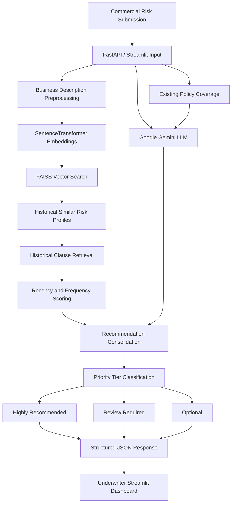

# Underwriting Intelligence – Hybrid AI Clause Recommendation Engine

An AI-powered underwriting decision-support platform combining semantic vector search, historical portfolio analytics and generative AI reasoning to identify potential policy coverage gaps and recommend relevant Property & Casualty (P&C) insurance clauses.

## 1. Project Overview

Commercial Property & Casualty underwriting involves evaluating complex business activities, property exposures and insurance coverage requirements.

Underwriters must identify relevant policy clauses and endorsements while considering historical underwriting decisions, industry-specific risks and existing policy coverage.

Manual review can be time-consuming and may lead to inconsistent recommendations or overlooked coverage requirements.

This project introduces a hybrid recommendation engine that combines historical portfolio intelligence with contextual LLM reasoning to help underwriters identify potentially relevant clauses.

**Key objectives:**
- Retrieve historically relevant commercial risk profiles using semantic search.
- Identify clauses associated with similar business activities.
- Rank candidate clauses using historical recency and frequency metrics.
- Use generative AI to identify additional potential coverage gaps.
- Categorize recommendations into actionable priority tiers.
- Provide structured recommendations and explanations through REST APIs and an interactive dashboard.

## 2. System Architecture

The platform follows a hybrid AI architecture combining three complementary capabilities:

1. **Semantic Retrieval:** Uses SentenceTransformers to encode commercial business descriptions into dense vector embeddings and FAISS to retrieve semantically similar historical risk profiles.
2. **Historical Recommendation Scoring:** Applies recency and frequency metrics to prioritize clauses based on historical portfolio patterns.
3. **Generative AI Reasoning:** Uses Google Gemini to analyze business activities and existing policy clauses, identifying additional potential coverage considerations.

The outputs are consolidated into a structured recommendation response for underwriting review.

### End-to-End Workflow

1. Underwriter submits a commercial business description, property details and existing policy clauses.
2. SentenceTransformers encodes the business description into a dense vector representation.
3. FAISS retrieves the nearest historical commercial risk profiles.
4. Associated historical policy clauses are collected from the retrieved records.
5. The recommendation engine calculates recency and frequency scores for candidate clauses.
6. Google Gemini receives the risk description, existing coverage and relevant context to generate additional clause recommendations.
7. Statistical and generative recommendations are consolidated.
8. Recommendations are categorized into three priority tiers.
9. Structured results and underwriting explanations are returned through FastAPI and displayed in Streamlit.

### Architecture Diagram

## 3. Key Technical Contributions

### Semantic Search and Vector Retrieval

Implemented a dense semantic retrieval pipeline using SentenceTransformers and FAISS.

- Integrated `all-MiniLM-L6-v2` for business activity embedding generation.
- Converted historical commercial risk descriptions into vector representations.
- Built a FAISS `IndexFlatL2` index for nearest-neighbor retrieval.
- Retrieved similar historical business activities and associated policy clauses.
- Implemented semantic fallback retrieval for business activities with limited exact historical matches.

This approach allows the system to identify related commercial activities even when the wording differs from historical portfolio descriptions.

### Historical Portfolio Recommendation Scoring

Developed a hybrid scoring mechanism to prioritize clauses using historical portfolio patterns.

- Incorporated recency information from historical underwriting records.
- Calculated clause frequency across historical business activities.
- Combined recency and frequency into a hybrid ranking score.
- Used historical relevance to support clause prioritization.

**Hybrid scoring concept:**

\[
S_{\text{hybrid}} = S_{\text{recency}} \times S_{\text{frequency}}
\]

The recency and frequency components are normalized or scaled according to the scoring implementation.

### Generative AI-Based Coverage Analysis

Integrated Google Gemini to provide contextual recommendations beyond the retrieved historical records.

- Developed prompts incorporating business descriptions and existing policy clauses.
- Used contextual reasoning to identify potentially relevant coverage considerations.
- Supported recommendations for unfamiliar or emerging commercial activities.
- Implemented structured JSON responses using schema-constrained generation.
- Integrated generated recommendations into the unified recommendation workflow.

### Hybrid Recommendation Architecture

Combined historical retrieval and LLM reasoning to provide complementary recommendation signals.

- Historical retrieval provides evidence from similar portfolio records.
- Recency and frequency scoring provide quantitative prioritization.
- Gemini provides contextual suggestions for potential gaps not represented in retrieved records.
- Consolidation logic organizes results into actionable recommendation categories.

### Underwriter Decision-Support Interface

Developed an interactive Streamlit dashboard for underwriting analysis.

- Enabled submission of business activity and existing policy clauses.
- Displayed recommended clauses in priority-based categories.
- Supported review of recommendation explanations.
- Integrated the dashboard with FastAPI endpoints.
- Provided structured outputs for downstream integration and audit review.

## 4. Technology Stack

| Category | Technologies |
|---|---|
| Programming Language | Python |
| Backend Framework | FastAPI, Uvicorn |
| Interactive Dashboard | Streamlit |
| Text Embeddings | SentenceTransformers |
| Embedding Model | all-MiniLM-L6-v2 |
| Vector Search | FAISS CPU, IndexFlatL2 |
| Generative AI | Google Gemini, Gemini 2.0 Flash |
| Data Processing | Pandas, NumPy |
| API Validation | Pydantic |
| Historical Data | CSV portfolio datasets |
| API Documentation | Swagger UI |

## 5. Performance and Business Impact

- **Faster underwriting review:** The reported workflow reduced clause review time from approximately 2–3 hours to under 10 seconds per submission in the tested context.
- **Semantic historical retrieval:** Enabled retrieval of similar commercial risk profiles without requiring exact text matches.
- **Improved recommendation coverage:** Combined historical portfolio patterns with contextual LLM-generated suggestions.
- **Consistent prioritization:** Introduced structured recommendation tiers to support more standardized underwriting reviews.
- **Emerging risk support:** Enabled contextual analysis of unfamiliar business activities with limited historical representation.

*The reported processing time should be validated against representative submissions and include the full retrieval, scoring, LLM and response-generation workflow. Improved loss ratios or avoided claims should be treated as potential business outcomes unless supported by measured portfolio evidence.*

## 6. Engineering Challenges

| Challenge | Solution |
|---|---|
| Unfamiliar commercial business activities | Semantic retrieval of analogous historical risk profiles |
| Exact keyword matching limitations | Dense transformer-based text embeddings |
| Large historical portfolio datasets | FAISS vector indexing and nearest-neighbor retrieval |
| Different historical relevance levels | Recency and frequency-based scoring |
| Missing coverage considerations | Contextual Gemini-based recommendation generation |
| Unstructured LLM responses | Schema-constrained JSON output |
| Recommendation explainability | Historical reference information and contextual justifications |

## 7. Architectural Design Decisions

### Why SentenceTransformers?

Traditional keyword matching struggles when business activities are described using different terminology.

SentenceTransformers generates dense vector representations that capture semantic relationships between descriptions, allowing the system to retrieve conceptually related commercial risks.

### Why FAISS?

FAISS provides efficient similarity search over dense vector representations.

The project uses `IndexFlatL2` for exact nearest-neighbor retrieval based on Euclidean distance, providing a straightforward baseline for historical risk matching.

### Why Combine Historical Retrieval with Gemini?

Historical portfolio data provides evidence of previously selected clauses, but it may not adequately cover emerging or unfamiliar commercial activities.

Gemini adds contextual reasoning to suggest additional considerations that may not appear in the retrieved records.

The hybrid architecture combines historical evidence and generative suggestions rather than relying exclusively on either approach.

### Why Structured JSON Generation?

Structured output makes it easier for downstream services to process recommendations consistently.

Schema-constrained generation helps enforce the expected response structure and reduces formatting errors, although the generated recommendations still require validation.

## 8. Project Highlights

- Hybrid semantic retrieval and generative AI recommendation architecture.
- SentenceTransformers-based dense text embeddings.
- FAISS nearest-neighbor historical risk retrieval.
- Recency and frequency-based clause ranking.
- Google Gemini contextual recommendation generation.
- Structured JSON response generation.
- Three-tier recommendation prioritization.
- FastAPI microservice integration.
- Streamlit underwriting decision-support dashboard.

## 9. Disclaimer

This repository describes the project's architecture, technical approach and engineering contributions. It does not contain proprietary source code, confidential underwriting datasets, customer information, internal APIs or production credentials.

The recommendation engine is intended to support underwriting review, not replace professional underwriting judgment. Generated recommendations and historical patterns require validation against applicable policy wording, underwriting guidelines and regulatory requirements.
