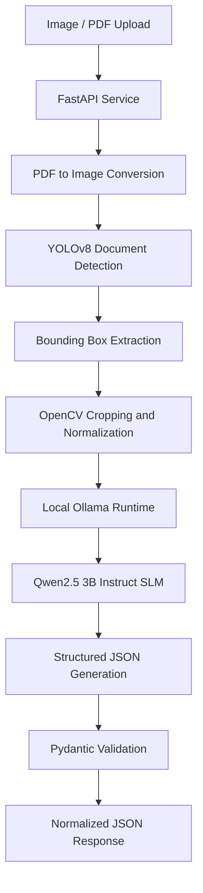

# Private Edge AI – Hybrid Vision-Language Document Extraction Platform

A privacy-focused document intelligence microservice combining YOLOv8 object detection with locally hosted Small Language Models (SLMs) to perform structured document extraction without relying on external cloud inference APIs.

## 1. Project Overview

The platform addresses the operational cost, latency and data privacy challenges associated with cloud-based document processing.

Traditional OCR pipelines often struggle with composite document images containing multiple cards, background noise and inconsistent document positioning. Small Language Models also face limitations when processing complex full-page document images directly.

This project introduces a hybrid Computer Vision and SLM architecture that separates document localization from information extraction.

YOLOv8 identifies and isolates document regions, while a locally hosted Qwen2.5 3B Instruct model processes the cropped images and generates structured JSON outputs.

**Key objectives:**
- Enable private, on-premise document processing.
- Eliminate external cloud inference dependencies for supported document classes.
- Support multiple documents or card sides within a single image.
- Optimize local model inference through quantized SLM deployment.
- Produce structured and validated extraction results.

## 2. Architecture

The system follows a two-stage AI processing architecture:

1. **Visual localization:** YOLOv8 detects document boundaries and identifies individual document regions.
2. **Information extraction:** A local Small Language Model processes each detected document crop and generates structured information.

### Processing Workflow

1. Receive image or PDF uploads through a FastAPI endpoint.
2. Convert PDF pages into image representations when required.
3. Run YOLOv8 object detection to identify document regions.
4. Extract detected regions using bounding-box coordinates.
5. Normalize and encode document crops for inference.
6. Send each crop to the locally hosted Ollama runtime.
7. Run Qwen2.5 3B Instruct with structured extraction instructions.
8. Parse and validate the generated JSON using Pydantic.
9. Return normalized extraction results through the API.

### Architecture Diagram

## 3. Key Technical Contributions

### Hybrid Computer Vision and SLM Architecture
- Designed a two-stage pipeline separating document localization from semantic information extraction.
- Integrated YOLOv8 for automated document detection and region segmentation.
- Used detected bounding boxes to isolate individual document regions before language-model inference.
- Enabled processing of composite images containing multiple documents or card sides.

### Local Small Language Model Deployment
- Integrated Qwen2.5 3B Instruct through the Ollama inference runtime.
- Used a quantized `q4_K_M` model to reduce local inference memory requirements.
- Implemented local REST-based model communication without external inference API dependencies.
- Supported CPU/GPU-based local inference environments.

### Structured LLM Extraction
- Engineered prompts for document-specific information extraction.
- Implemented schema-oriented JSON generation instructions.
- Integrated Pydantic models to validate output structures and handle missing fields.
- Added exception handling and fallback mechanisms for malformed model responses.

### Image Processing and Document Segmentation
- Implemented automated document cropping using YOLOv8 bounding boxes.
- Used OpenCV for image-region extraction and normalization.
- Processed PDF pages through PyMuPDF.
- Prepared cropped image buffers for local model inference.

### API and Inference Engineering
- Developed a FastAPI microservice exposing document extraction endpoints.
- Integrated the local Ollama REST API.
- Implemented request-level logging and processing-time measurements.
- Designed an end-to-end inference workflow from document upload to validated JSON output.

## 4. Technology Stack

| Category | Technologies |
|---|---|
| Language | Python |
| Backend | FastAPI, Uvicorn |
| Object Detection | Ultralytics YOLOv8 |
| Image Processing | OpenCV |
| PDF Processing | PyMuPDF |
| Small Language Model | Qwen2.5 3B Instruct |
| Inference Runtime | Ollama |
| Model Quantization | GGUF, Q4_K_M |
| Data Validation | Pydantic |
| API Communication | HTTPX |
| Testing | Postman, Jupyter Notebook |

## 5. Performance and Business Impact

- **Cloud independence:** Eliminated external cloud inference API dependencies for the supported document-processing workflow.
- **Data privacy:** Kept sensitive document images and extraction processing within the private infrastructure.
- **Processing flexibility:** Enabled automated extraction from composite images containing multiple document regions.
- **Resource optimization:** Used a quantized 3B-parameter SLM to reduce local inference memory requirements.
- **Operational cost:** Removed recurring external vision API charges for the targeted processing workflow.

*Note: Local infrastructure, hardware and maintenance costs still apply. The cloud-cost benefit refers specifically to the elimination of external inference API charges.*

## 6. Engineering Challenges

| Challenge | Solution |
|---|---|
| Multiple documents in one image | YOLOv8-based document localization and cropping |
| Background noise and complex layouts | Isolated document regions before SLM inference |
| Small-model hallucinations | Explicit extraction instructions and schema-oriented output constraints |
| Invalid JSON responses | Pydantic validation and fallback handling |
| Limited inference resources | Q4_K_M quantized SLM deployment |
| External data privacy concerns | Local Ollama inference without external model API calls |

## 7. Architectural Design Decisions

The project deliberately separates visual detection from semantic extraction.

YOLOv8 handles spatial localization, while Qwen2.5 3B handles document understanding and structured field generation.

This division reduces the visual complexity presented to the SLM and allows each component to be optimized independently.

The use of a quantized model provides a practical balance between model size and local inference resource requirements.

## 8. Project Highlights

- Hybrid Computer Vision and Small Language Model architecture.
- YOLOv8-based automated multi-document detection.
- Private, on-premise LLM inference using Ollama.
- Quantized Qwen2.5 3B deployment.
- Schema-oriented structured JSON extraction.
- FastAPI-based production service integration.

## 9. Disclaimer

This repository documents the project's architecture, technical approach and engineering contributions. It does not contain proprietary source code, confidential customer documents, model credentials, internal endpoints or sensitive personal information.
