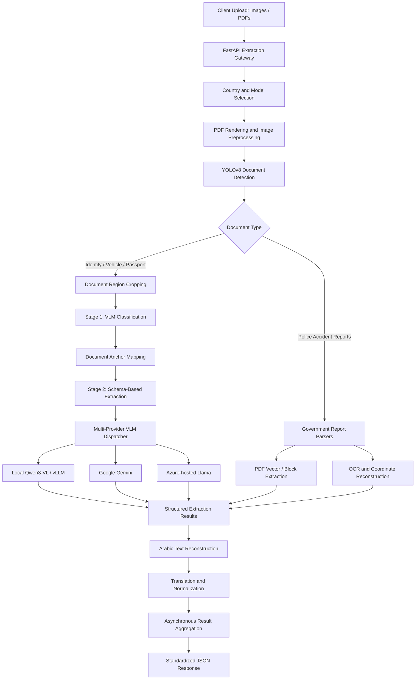

# GCC Unified Vision-Language Document Intelligence – Multi-Provider OCR Platform

## 1. Project Overview

An enterprise-oriented multimodal document intelligence platform designed to unify document processing across multiple GCC insurance operations.

The platform combines deep learning-based document segmentation, vision-language model (VLM) orchestration, dynamically generated extraction schemas, and specialized governmental accident report parsers.

It supports composite document uploads containing multiple identity cards, vehicle documents, passports, and multi-page police accident reports.

Instead of maintaining disconnected OCR pipelines for each document category, the architecture provides a centralized extraction gateway with interchangeable local and cloud-based AI inference providers.

### Key capabilities

- Multi-document detection and spatial segmentation using YOLOv8.
- Two-stage VLM classification and structured information extraction.
- Pluggable inference providers supporting local and cloud models.
- Dynamic Pydantic and JSON schema generation.
- Specialized parsers for governmental police accident reports.
- Arabic text reconstruction and translation.
- Asynchronous processing of multiple document regions.
- Standardized JSON responses across supported document categories.

## 2. System Architecture

The platform uses a hybrid architecture combining multimodal AI inference with deterministic document-processing components.



## 3. End-to-End Processing Workflow

### Stage 1 – Request Ingestion and Provider Selection

A centralized FastAPI service accepts image and PDF uploads through country-specific extraction routes.

The request configuration supports:

- Country or jurisdiction selection.
- Document processing route selection.
- Model-provider selection.
- Multiple document uploads.
- Standardized response formatting.

The architecture separates API routing from the underlying extraction engine, allowing inference providers and document-processing components to evolve independently.

### Stage 2 – PDF Rendering and YOLOv8 Document Segmentation

PDF pages are rendered into images using PyPDFium2, with image processing and cropping handled through OpenCV and Pillow.

A custom YOLOv8 model detects individual document regions within composite uploads.

**Detection configuration:**

| Parameter | Value |
|---|---|
| Model | Custom YOLOv8 document detector |
| Model artifact | `yolo-multipage-OCR-cls.pt` |
| Confidence threshold | 0.50 |
| IoU threshold | 0.40 |
| PDF rendering | 2.0x scale |
| Processing | Bounding-box detection and cropping |

The segmentation workflow:

1. Render PDF pages into images.
2. Detect document regions.
3. Extract individual document crops.
4. Route detected regions to the extraction pipeline.
5. Use full-frame processing as a fallback when no document regions are detected.
6. Identify and skip unsupported or irrelevant pages where applicable.

This enables multiple cards submitted in a single scanned image or PDF page to be processed independently.

### Stage 3 – Two-Stage Vision-Language Model Processing

The platform uses a two-stage VLM workflow to separate document identification from field extraction.

**Stage 3.1 – Document Classification**

Each cropped document image is submitted to the selected VLM alongside jurisdiction-specific document anchor definitions.

The classification engine identifies the expected document category, such as:

- Driving license front and back.
- Vehicle registration front and back.
- Residency permit.
- Emirates identity documents.
- Regional identity documents.
- International passports.

The classification output is mapped to the corresponding document configuration.

**Stage 3.2 – Structured Information Extraction**

After classification, the extraction engine loads the relevant document schema from the jurisdiction-specific configuration.

It dynamically constructs a structured extraction request using the expected output fields.

Key implementation elements:

- Pydantic-based schema definitions.
- Dynamic JSON schema generation.
- Strict structured-output configuration where supported by the provider.
- `additionalProperties: false` to restrict unexpected fields.
- Temperature configuration of 0.0 where supported.
- Standardized response mapping.

The same extraction interface can dispatch requests to different VLM providers without requiring separate country-specific implementations of the entire inference pipeline.

*Structured-output constraints improve response-format reliability but do not guarantee that extracted values are factually correct.*

### Stage 4 – Multi-Provider VLM Execution Engine

A provider-dispatching layer allows the platform to use different multimodal models according to deployment requirements.

| Provider | Model / Runtime | Execution environment |
|---|---|---|
| Qwen | Qwen3-VL-4B-Instruct | Local vLLM |
| Google | Gemini 3 Flash Preview | Cloud inference |
| Azure | Llama 4 Scout 17B Instruct | Azure AI |

The engine integrates different SDK and invocation patterns, including:

- AsyncOpenAI-compatible interfaces.
- LangChain model integrations.
- Google GenAI integrations.
- Azure-hosted model execution.

The provider abstraction allows model selection to be separated from document-specific extraction logic.

This supports model comparison, deployment flexibility, and the ability to route selected document classes through private infrastructure.

### Stage 5 – Specialized Governmental Police Report Extraction

Governmental accident reports often contain complex tables, multi-column layouts, and jurisdiction-specific field positions.

Rather than treating every report as a generic VLM extraction task, the platform uses dedicated parsing workflows.

| Jurisdiction / Report | Extraction approach |
|---|---|
| Abu Dhabi Saaed | PyMuPDF vector and table extraction |
| Dubai Police | Concurrent PDF block and text extraction |
| Sharjah Rafid | High-resolution rendering, Google Cloud Vision OCR, coordinate reconstruction |
| Doha Traffic Police | PDF block/span extraction and Google Cloud Vision OCR |

**Sharjah coordinate reconstruction**

A custom coordinate sorting module was implemented to preserve the logical reading order of two-column police accident reports.

The algorithm:

1. Extract OCR text blocks and their bounding-box coordinates.
2. Group blocks into horizontal bands using a vertical tolerance.
3. Sort elements within each band according to their horizontal positions.
4. Reconstruct the document's intended reading order.

This addresses line scrambling that can occur when OCR output is sorted using a simple top-to-bottom sequence.

### Stage 6 – Arabic Text Reconstruction and Translation

The platform supports Arabic and bilingual document-processing workflows.

Key components:

- `arabic-reshaper` for Arabic character shaping.
- `python-bidi` for bidirectional text presentation.
- Coordinate-aware text ordering for spatial reconstruction.
- `deep_translator` for translating selected accident narratives and driver remarks.

These components help standardize extracted text for downstream processing and English-language reporting.

### Stage 7 – Concurrent Processing and Response Aggregation

The API uses asynchronous execution to coordinate independent document-processing tasks.

Key technologies:

- Python `asyncio`.
- `asyncio.gather`.
- `ThreadPoolExecutor` for selected synchronous parsing operations.
- FastAPI asynchronous request handling.

Individual document results are aggregated into a standardized JSON response.

This allows the system to process multiple detected document regions within a single request while keeping country-specific extraction logic modular.

## 4. Technology Stack

| Category | Technologies |
|---|---|
| Programming | Python 3.11 |
| API Framework | FastAPI, Uvicorn |
| Computer Vision | Ultralytics YOLOv8, OpenCV, Pillow |
| PDF Processing | PyPDFium2, PyMuPDF |
| Image Rendering | Wand, ImageMagick |
| Vision-Language Models | Qwen3-VL, Gemini, Llama 4 Scout |
| Model Serving | vLLM, Azure AI Services, Google GenAI |
| AI Orchestration | LangChain Core, LangChain OpenAI, LangChain Google GenAI |
| Structured Output | Pydantic, JSON Schema |
| OCR | Google Cloud Vision |
| Arabic Processing | arabic-reshaper, python-bidi |
| Translation | deep-translator |
| Concurrency | asyncio, ThreadPoolExecutor |
| Development | VS Code, Jupyter Notebook, Git |

## 5. Key Engineering Contributions

### Unified GCC Document Intelligence Architecture

Designed a centralized extraction platform to consolidate country-specific document processing workflows into a modular API architecture.

### YOLOv8-Based Multi-Document Detection

Integrated a custom object detection model to identify and crop multiple document regions from composite uploads and multi-page PDF inputs.

### Two-Stage VLM Orchestration

Separated document classification from field extraction, enabling the system to select the appropriate document schema before generating structured output.

### Dynamic Schema Generation

Developed a configurable extraction engine that translates document definitions into structured Pydantic and JSON schema representations.

### Multi-Provider AI Integration

Designed a common execution layer for local vLLM inference and external multimodal model providers, supporting model selection without duplicating the full extraction workflow.

### Specialized Government Report Parsers

Implemented jurisdiction-specific parsing mechanisms for accident reports, combining PDF vector extraction, OCR, concurrent processing, and coordinate-based reconstruction.

### Arabic Document Processing

Integrated bidirectional text reconstruction and translation components to support bilingual regional document workflows.

## 6. Engineering Challenges and Solutions

| Engineering challenge | Technical solution |
|---|---|
| Multiple documents inside one upload | YOLOv8-based document region detection and cropping |
| Different document types requiring different fields | Two-stage classification and dynamic schema selection |
| Multiple model providers with different SDKs | Provider abstraction and unified dispatch layer |
| Classification keys not matching extraction schemas | Corrected document anchor and output dictionary mapping |
| Strict JSON output requirements | Provider-supported structured output and schema validation |
| Multi-column accident report text scrambling | Coordinate-based horizontal grouping and sorting |
| Arabic bidirectional text | Arabic reshaping and bidi reconstruction |
| Multiple independent document-processing tasks | Asynchronous orchestration and concurrent parsing |

### Notable Debugging Case – Document Key Mapping

An integration issue occurred when the classification anchor dictionary used shortened document identifiers while the extraction schema dictionary expected full document identifiers.

This caused an incorrect mapping between classification results and extraction configurations, resulting in failed extraction requests.

The issue was traced through the model-engine implementation and debugging notebook.

The mapping was corrected to ensure that classification outputs resolve to the expected extraction schema.

This highlighted the importance of maintaining consistent document identifiers across classification, schema configuration, and response-generation layers.

## 7. Business and Operational Value

### Regional Platform Consolidation

The architecture provides a common processing gateway for multiple regional document categories and jurisdiction-specific extraction workflows.

### Model-Provider Flexibility

The platform can route requests through local or cloud inference backends according to operational, privacy, and model-performance requirements.

### Reduced Pipeline Duplication

Shared segmentation, classification, schema generation, and provider-dispatch components reduce the need to independently implement the entire extraction workflow for every document category.

### Improved Composite Document Processing

YOLO-based document detection enables the system to process multiple document regions from a single upload rather than requiring every document to be submitted separately.

### Specialized Government Report Processing

Dedicated parsers preserve jurisdiction-specific layouts and extraction rules instead of relying exclusively on generic OCR or VLM output.

## 8. Project Highlights

- Unified multimodal document intelligence across multiple GCC jurisdictions.
- Custom YOLOv8 multi-document detection and cropping.
- Two-stage VLM classification and structured extraction.
- Local and cloud model-provider integration.
- Dynamic Pydantic and JSON schema generation.
- Specialized governmental accident report parsers.
- Coordinate-based reconstruction of multi-column OCR output.
- Arabic text reconstruction and translation.
- Asynchronous processing and standardized JSON aggregation.

## 9. Repository Structure

```text
VL_version_OCR/
│
├── app.py
├── routers/
│   └── extract.py
│
├── services/
│   ├── llm_engine.py
│   └── coordinates_sort.py
│
├── models/
│   └── document_detection/
│
├── configurations/
│   ├── document_anchors/
│   └── output_schemas/
│
├── debug.ipynb
└── README.md
```

*Representative structure only. Include directories and files in the public repository only when they actually exist and are safe to disclose.*

## 10. Technical Disclaimer

This repository describes the architecture and engineering concepts behind a regional document intelligence platform.

Production source code, internal infrastructure addresses, credentials, private model endpoints, customer documents, government report samples, proprietary model artifacts, and organization-specific configurations are excluded.

The use of strict structured-output schemas does not eliminate semantic extraction errors or guarantee zero hallucinations. Extracted information should be validated according to the requirements of the downstream business process.
