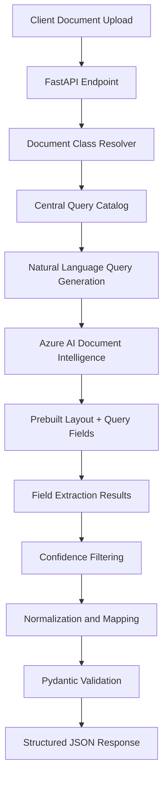

# Query-Driven Document Intelligence – Zero-Shot AI Extraction Platform

A schema-driven document extraction service that leverages Azure AI Document Intelligence and natural-language queries to extract structured information from dynamic document formats without requiring custom model training.

## 1. Project Overview

The platform addresses the traditional dependency on labeled datasets and custom neural model training for onboarding new document formats.

Using Azure AI Document Intelligence's `prebuilt-layout` model with Query Fields capabilities, the service dynamically extracts requested information through natural-language queries instead of relying exclusively on predefined document templates.

The solution is designed for insurance and enterprise document processing, supporting flexible extraction requirements across GCC identity and motor insurance documents.

**Key objectives:**
- Eliminate repetitive custom-model training for new document variations.
- Enable dynamic field extraction through natural-language queries.
- Separate extraction requirements from application logic using centralized query configurations.
- Improve adaptability to document layout variations.

## 2. Architecture

The service follows a query-driven extraction architecture in which document classes and their required fields are resolved through a centralized query catalog.

### Processing Workflow

1. Receive document uploads and document-class identifiers through FastAPI.
2. Resolve the requested document class against the centralized query catalog.
3. Generate the corresponding natural-language field queries.
4. Submit the document and queries to Azure AI Document Intelligence using the `prebuilt-layout` model with Query Fields enabled.
5. Retrieve extracted values and associated confidence scores.
6. Map query results to predefined JSON fields.
7. Apply confidence filtering, normalization and Pydantic validation.
8. Return structured JSON responses.

### Architecture Diagram

## 3. Key Technical Contributions

### Zero-Shot Query-Based Extraction
- Integrated Azure AI Document Intelligence's `prebuilt-layout` model with Query Fields functionality.
- Implemented natural-language queries to retrieve requested document attributes dynamically.
- Reduced dependence on custom document-specific model training and annotation.

### Centralized Query Configuration
- Designed a centralized query catalog mapping document classes to their extraction fields.
- Separated extraction definitions from API execution logic.
- Enabled new field requirements through configuration changes rather than application-level extraction rewrites.

### Prompt Engineering and Query Optimization
- Developed concise, context-aware natural-language questions for visual document understanding.
- Calibrated query phrasing using document labels and field-position context.
- Reduced redundant queries to improve extraction efficiency and control API consumption.

### Structured Extraction and Validation
- Implemented response parsing and field mapping.
- Applied confidence-based filtering to extracted values.
- Integrated Pydantic validation and normalization for consistent downstream JSON responses.

### Backend API Engineering
- Developed REST endpoints using FastAPI.
- Integrated the Azure AI Document Intelligence SDK.
- Implemented request handling, document processing and API logging.
- Supported PDF document ingestion and processing.

## 4. Technology Stack

| Category | Technologies |
|---|---|
| Language | Python |
| Backend | FastAPI, Uvicorn |
| Document AI | Azure AI Document Intelligence |
| AI Capabilities | Prebuilt Layout, Query Fields |
| Prompt Engineering | Natural-language query design |
| Data Validation | Pydantic |
| Configuration | JSON-based query catalogs |
| API Testing | Postman, Swagger UI |
| Development | VS Code |

## 5. Performance and Business Impact

- **Faster onboarding:** Reduced new document-format onboarding from an estimated 2–4 weeks to minutes for supported query-based extraction scenarios.
- **Reduced training dependency:** Eliminated custom model annotation and training requirements for suitable new document variations.
- **Improved adaptability:** Enabled extraction requirements to evolve through centralized query configuration.
- **Operational flexibility:** Supported rapid prototyping of extraction schemas for insurance and enterprise documents.

## 6. Engineering Challenges

| Challenge | Solution |
|---|---|
| Ambiguous natural-language queries | Calibrated concise queries using document labels and contextual cues |
| High API latency from multiple queries | Pruned redundant queries and optimized query definitions |
| Inconsistent extraction confidence | Implemented confidence-based filtering |
| Changing document layouts | Used query-driven visual grounding instead of fixed coordinate assumptions |
| New field onboarding | Introduced centralized query catalogs |

## 7. Architectural Trade-offs

The query-driven approach provides flexibility and reduces custom model training requirements, but introduces additional cloud API latency and consumption costs.

It is particularly suitable for:
- Rapid onboarding of new document formats.
- Dynamic extraction requirements.
- Low-to-medium-volume document processing.
- Scenarios where custom model training is not justified.

For stable, high-volume document templates, a dedicated custom extraction model or optimized local extraction pipeline may offer better cost and latency characteristics.

## 8. Project Highlights

- Zero-shot, natural-language-driven document extraction.
- Dynamic field querying without custom model retraining.
- Centralized, configuration-driven extraction architecture.
- Confidence-aware structured information extraction.
- Production-oriented FastAPI microservice integration.

## 9. Disclaimer

This repository documents the project's architecture, technical approach and engineering contributions. It does not contain proprietary source code, confidential business documents, credentials or sensitive customer information.
